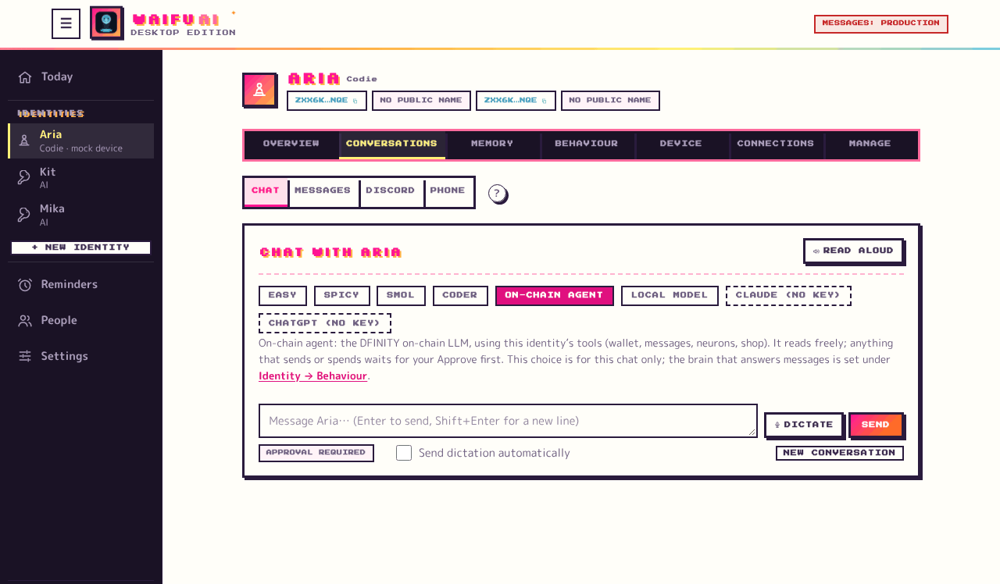
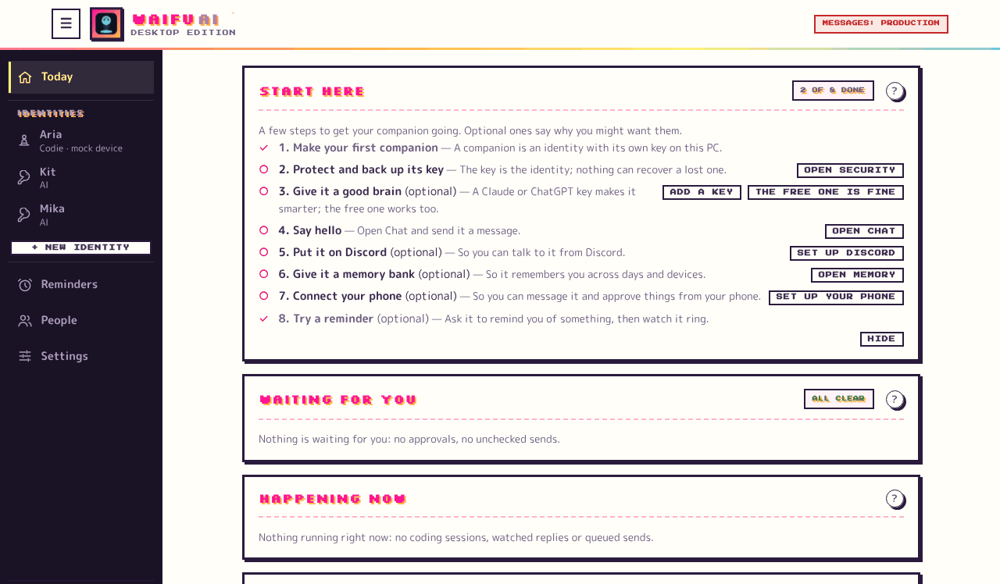
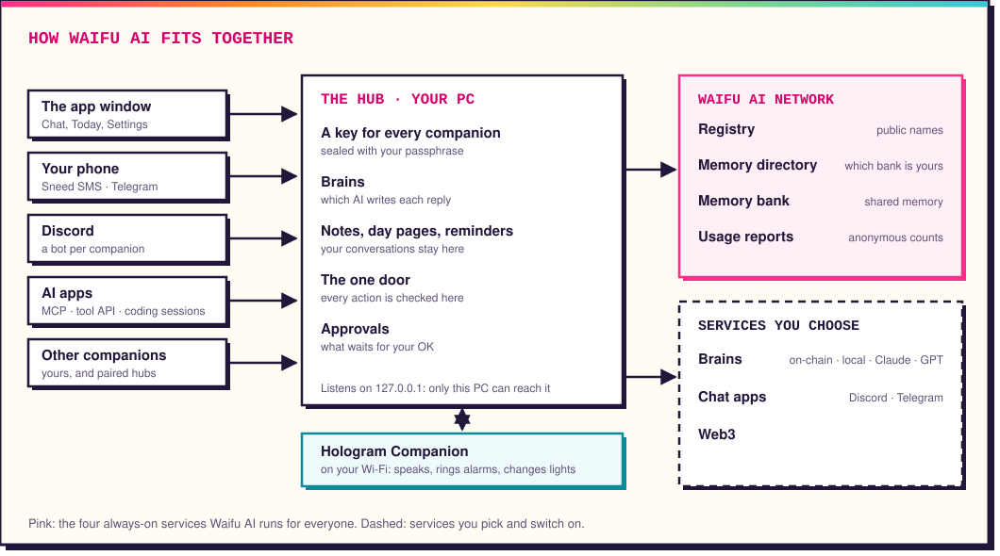
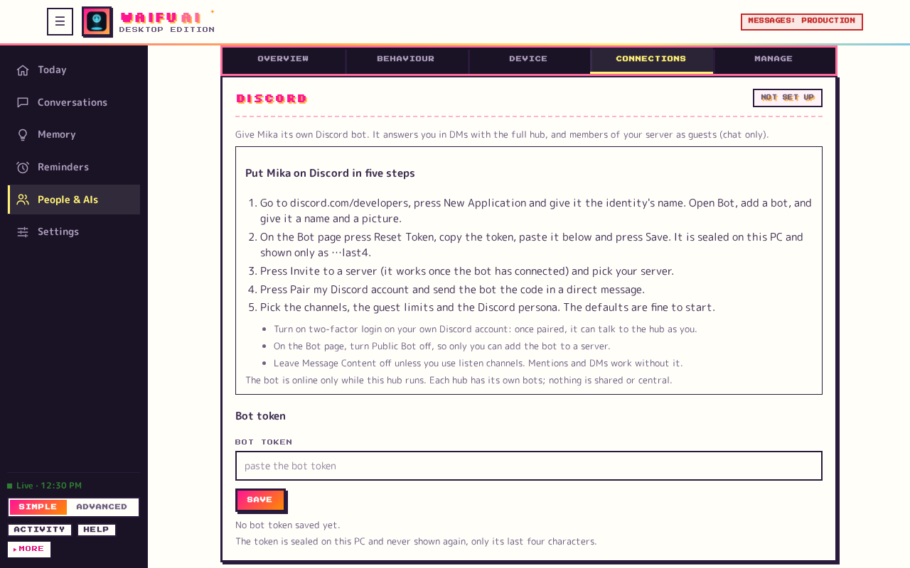
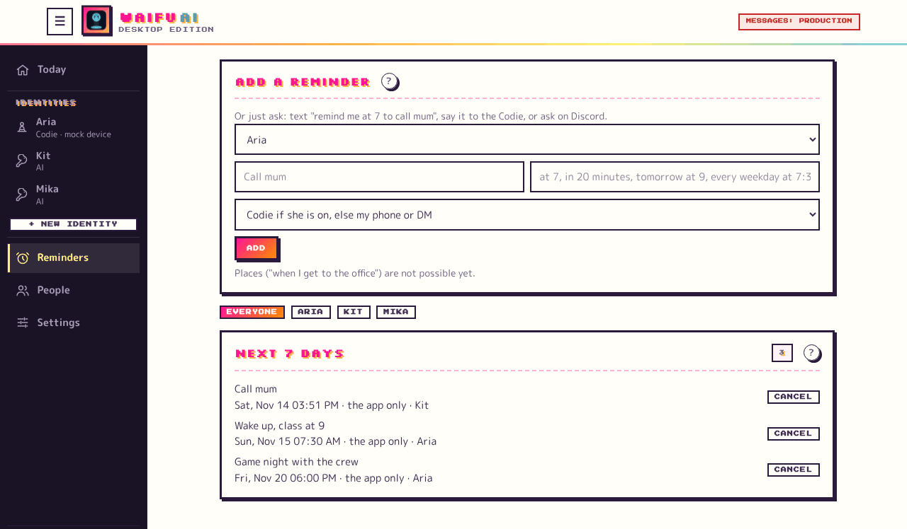
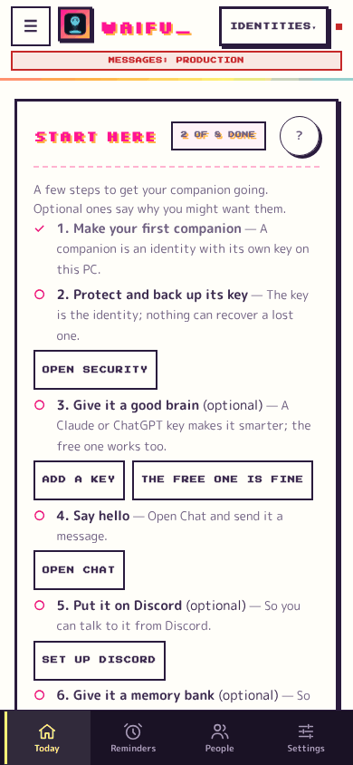
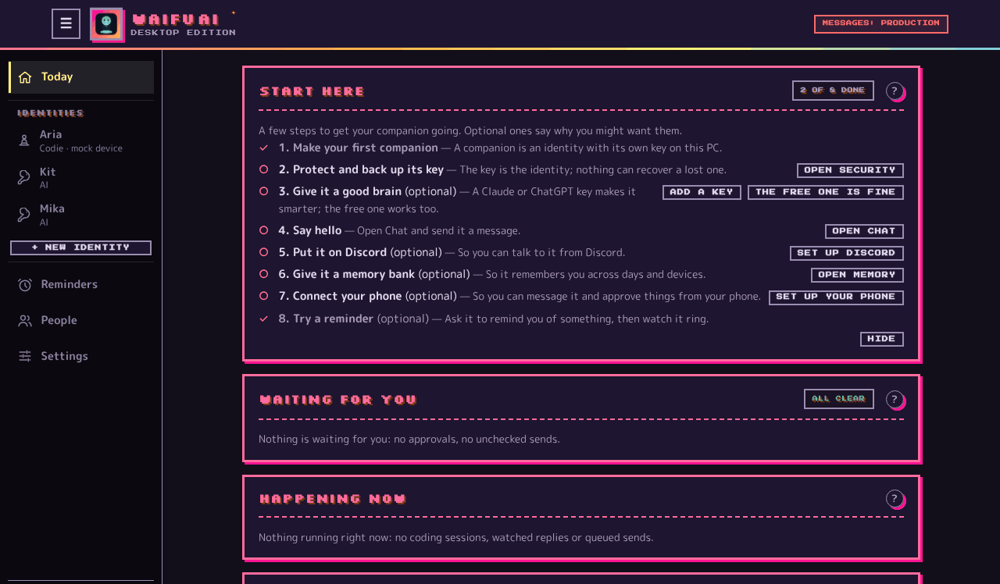

  

<h1 align="center">Waifu AI Desktop</h1>

<b>Your AI companions, living on your own PC. They remember you, they work together, and they only send, spend or change things when you say OK.</b>

  <a href="../../releases/latest"><b>⬇️ Download for Windows</b></a> ·
  <a href="https://claude.ai/artifact/Hi2RCPNv8xwBT3G7P8QTPZ"><b>📗 Handbook</b></a> ·
  <a href="docs/guides/README.md">📖 User guides</a> ·
  <a href="docs/HOW_IT_WORKS.md">⚙️ How it works</a> ·
  <a href="docs/USE_CASES.md">📘 Use cases</a> ·
  <a href="docs/NETWORK.md">🌐 Network</a> ·
  <a href="docs/FAQ.md">❓ FAQ</a>

  

---

## At a glance

<table>
<tr>
<td width="25%" valign="top"><h3>🔑 It's yours</h3>Each companion <b>is</b> a key that lives only on your PC. No account, no subscription, no cloud server holding your stuff.</td>
<td width="25%" valign="top"><h3>🧠 It remembers</h3>"Remember that my sister's name is Ana." Notes, a page for each day, and a nightly dream that tidies what it knows.</td>
<td width="25%" valign="top"><h3>🤝 It's a team</h3>Companions message each other, can share one memory, and one of them can run small jobs across the rest.</td>
<td width="25%" valign="top"><h3>✅ You decide</h3>Anything that sends, spends or changes things waits for your OK, in the app or from your phone.</td>
</tr>
</table>

**Waifu AI Desktop** is a small **hub** that runs on your Windows PC. In it you make **companions**: AIs with
their own name, memory, personality and key. Each one is a real identity on the Internet Computer, so it can
message, hold tokens and be found by name. Talk to them in the app, on Discord, on Telegram or by text from your
phone, or give one a body: a **Hologram Companion** on your Wi-Fi speaks its replies out loud.

## Get started in 5 minutes

| Step | What to do |
|---|---|
| **1. Download** | `waifu-ai-vX.Y.Z-win-x64.zip` from [**Releases**](../../releases/latest). |
| **2. Unzip** | Into a folder you'll keep, such as Documents (not Downloads). Nothing to install. |
| **3. Start** | Double-click `Waifu AI.exe` and accept the Terms of Use. |
| **4. Make a companion** | On Today, press **Create your first identity**: pick a type, a name and a passphrase. The free brain is fine. |
| **5. Say hello** | Click it in the left column, open **Conversations → Chat**, and type "Hi! What can you do?" |

> 🛡️ **"Windows protected your PC"?** The app isn't code-signed yet. Click **More info → Run anyway**.
> Full walkthrough: [Getting started](docs/guides/01-getting-started.md).

<table>
<tr>
<td width="50%"> <b>The wizard:</b> type, name, device, key protection.</td>
<td width="50%"> <b>Today:</b> a Start here checklist, what waits for you, what's coming up.</td>
</tr>
</table>

## How it works

The thinking happens on **your PC**. Four small always-on services on the Internet Computer give your companions
a public name, a shared memory and a way to tell us what broke, and the hub works without any of them. Every
message, from every channel, goes through **one door** where the same checks run every time.
More in [**How it works**](docs/HOW_IT_WORKS.md).

## You stay in charge

- **Writes wait for you** by default. Loosen it per companion under **Behaviour → Actions & autonomy**, with
  starter profiles and Undo.
- **Money never moves on its own** unless you set a spend cap. A connected app never moves money at all.
- **Someone else's words** (a web page, a picture, a stranger's message, something heard in the room) make
  anything that turn wants to do wait for you.
- **Emergency brake:** text `stop all writes` from your phone. `resume writes` lifts it.
- **Unsafe mode** (off by default) lets what *you* ask from your own Discord DM run with no confirmation, until
  the time you pick. Turn it off from anywhere by texting `unsafe off`.

## Pick a brain

| Brain | Cost | Uses tools | Day pages & dreams |
|---|---|:-:|:-:|
| **On-chain agent** (the default) | Free, no key | ✅ | — |
| **Personas**: Easy, Spicy, Smol, Coder | Free | — | — |
| **Local model** on your PC | Free | ✅ | — |
| **Claude** or **ChatGPT** with your key | You pay the provider, with a monthly budget per companion | ✅ | ✅ |

When a companion's budget runs out, it uses the free brain until the 1st. More in
[Companions and brains](docs/guides/02-companions-and-brains.md).

## Talk anywhere

<table>
<tr>
<td width="34%" valign="top"> <b>Discord:</b> a bot of its own, with guided setup.</td>
<td width="33%" valign="top"> <b>Reminders:</b> "remind me at 7:30 to call mum".</td>
<td width="33%" valign="top"> <b>Phone-sized:</b> a bar of four at the bottom.</td>
</tr>
</table>

💬 The app's Chat · 🎮 a Discord bot per companion · ✈️ one Telegram bot per hub · 📱 Sneed SMS from your phone ·
✨ out loud to a Hologram Companion · 🔌 your own AI tools over MCP.

## What you need

- A **Windows PC, 64-bit (x64)**, with an internet connection. The unzipped app is about 100 MB.
- That's all to start. Optional: an **Anthropic** or **OpenAI** API key, a **Discord** server you own,
  **Telegram**, an **Internet Identity** (free) for the shared memory bank, and a **Hologram Companion**.

Your companions are online only while Waifu AI runs: a sleeping PC means a sleeping bot.

## Guides

| | Guide | Read it when… |
|---|---|---|
| 🚀 | [01 · Getting started](docs/guides/01-getting-started.md) | You've just downloaded the app |
| 🧩 | [02 · Companions and brains](docs/guides/02-companions-and-brains.md) | You want more companions, a smarter brain, or an orchestrator |
| 💬 | [03 · Talking everywhere](docs/guides/03-talking-everywhere.md) | Discord, Telegram, your phone, approvals, Unsafe mode |
| 🌙 | [04 · Memory and dreams](docs/guides/04-memory-and-dreams.md) | Notes, day pages, dreaming, the memory bank, reminders |
| ✨ | [05 · Your Hologram Companion](docs/guides/05-your-hologram-companion.md) | You have the hologram device |
| 🛡️ | [06 · Money and safety](docs/guides/06-money-and-safety.md) | Passphrase, backups, the wallet, approvals, limits |
| 🔧 | [07 · Updates and troubleshooting](docs/guides/07-updates-and-troubleshooting.md) | A new version is out, or something is off |

Prefer one page with charts and screenshots? Read the [**Waifu AI Handbook**](https://claude.ai/artifact/Hi2RCPNv8xwBT3G7P8QTPZ).
Inside the app, **Help** in the **☰** menu and the **?** on each card open help for exactly where you are.
From one Hologram Companion on a desk to a 50-bot creator network: eleven [**use cases**](docs/USE_CASES.md)
with diagrams, budgets and the limits to plan around.

## Privacy, in plain words

| Stays on your PC | Leaves your PC, only when you use it |
|---|---|
| Your companions' keys and your passphrase | A message, through the service that carries it (Discord, Telegram, Sneed SMS) |
| Your API keys and bot tokens | A reply's prompt, to the brain you picked, with your key |
| Your conversations, local notes and contacts | Memories you put in the shared bank, readable only by you and your enrolled companions |

On Windows these are encrypted even before you set a passphrase; a passphrase locks them tighter.
⚠️ Sneed SMS messages are **not encrypted**: treat them like postcards.

**The anonymous daily usage report** sends **counts only** once a day: app version, system type, which features
and brains are used, success and error counts, timing ranges and crash signatures. It **never** includes your
messages, memories, contacts, names, keys, addresses, Discord or phone IDs, or anything you type, and it carries
only a random number that changes every month. Read the last one, exactly as sent, in
**Settings → Updates → Usage report**.

## Updating

Waifu AI checks for a new version once a day (it sends nothing about you; untick it in **Settings → Updates**).

1. When **Settings → Updates** offers a new version, press **Download**. It's checked before it's kept.
2. Unzip it into a **new** folder.
3. Quit Waifu AI (**☰ → Quit**), then start `Waifu AI.exe` from the new folder.

Your companions, keys and settings live apart from the app folder, so nothing is lost. Each release lists the
zip's `sha256` so you can check the download yourself.

## Your data and backups

Everything your companions are lives in Waifu AI's data folder under `%APPDATA%`, not in the app folder.
But a companion **is** its key: lose the key without a backup and that companion is gone for good.

1. **Set a passphrase:** **Settings → Security & backups → Keys → Set a passphrase**. A forgotten one can't be recovered, so also…
2. **Back up:** **Back up keys** (just the companions) or **Export hub** (everything, and how you move to a new PC).
3. **Turn on scheduled backups**, daily or weekly, to a drive that isn't this PC's disk.

More in [Money and safety](docs/guides/06-money-and-safety.md).

## License

**This is not free software.** It is proprietary; see [`LICENSE`](LICENSE) for the full terms. In short: all
rights reserved; no copying, modifying, or redistribution. Portions (the Shopify Dev Kit) are owned by
International Waters Esports Palace; bundled third-party open-source components keep their own licenses, listed
in [`THIRD_PARTY_NOTICES.txt`](THIRD_PARTY_NOTICES.txt). Being able to see or download these files does not
grant any right to redistribute them.

For licensing inquiries: smugandcomfy@gmail.com

## Support and contact

- **Something not working?** Check [Troubleshooting](docs/guides/07-updates-and-troubleshooting.md) and the [FAQ](docs/FAQ.md) first.
- **Still stuck?** Open an [issue](../../issues). **Settings → Security & backups → Sessions and diagnostics →
  Copy diagnostics** makes a short report to paste in (keys and tokens are removed; it does include your
  companions' names, so trim those if you like). Never post your keys, passphrase, API keys, bot tokens or
  backup files.
- **What's new:** every version's notes are on the [Releases](../../releases) page.

 
Kawaii Night, one of six themes. More is on the way. 💖

