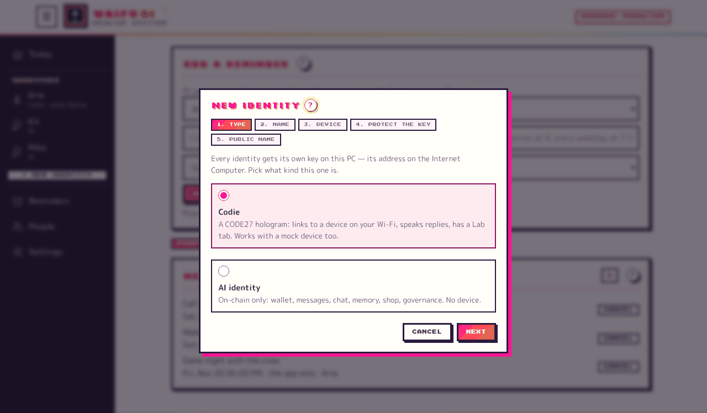
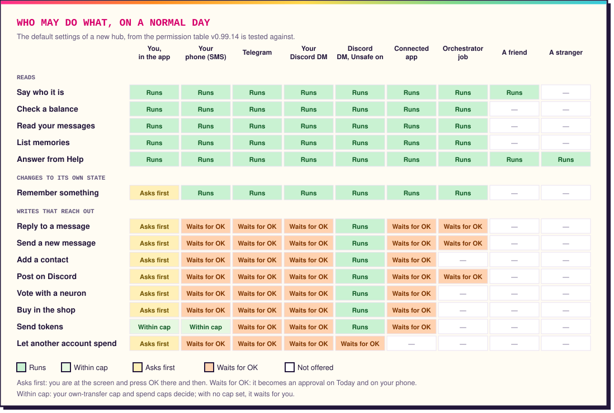

  

<h1 align="center">Waifu AI Desktop</h1>

<b>Your AI companions, living on your own PC. They remember you, they work together, and they only send, spend or change things when you say OK.</b>

  <a href="../../releases/latest"><b>⬇️ Download for Windows</b></a> ·
  <a href="#get-started-in-5-minutes"><b>🚀 Get started</b></a> ·
  <a href="#things-you-can-do">💡 Things you can do</a> ·
  <a href="docs/guides/README.md">📖 User guides</a> ·
  <a href="docs/USE_CASES.md">📘 Use cases</a> ·
  <a href="docs/FAQ.md">❓ FAQ</a>

  

---

## What is it?

**Waifu AI Desktop** is a small app (we call it the **hub**) that runs on your Windows PC. In it you create
**companions**: AI characters with their own name, personality, memory and key. You can talk to them in the app,
on Discord, on Telegram, by text from your phone, or out loud through a **Hologram Companion** on your Wi-Fi.

<table>
<tr>
<td width="25%" valign="top"><h3>🔑 It's yours</h3>Each companion's key lives only on your PC. No account, no subscription, no cloud server holding your stuff.</td>
<td width="25%" valign="top"><h3>🧠 It remembers</h3>"Remember that my sister's name is Ana." Notes, a page for each day, and a nightly dream that tidies what it knows.</td>
<td width="25%" valign="top"><h3>🤝 It's a team</h3>Companions message each other, can share one memory, and one of them can run small jobs across the rest.</td>
<td width="25%" valign="top"><h3>✅ You decide</h3>Anything that sends, spends or changes things waits for your OK, in the app or from your phone.</td>
</tr>
</table>

## What's new in 0.99.18 (pre-release)

> 🧪 **0.99.18 is a pre-release for testers.** Download it from the [**v0.99.18 release**](../../releases/tag/v0.99.18).
> The newest stable version is always under [**Latest**](../../releases/latest). Your hub keeps offering stable
> versions only, unless you tick **Also offer test releases** in **Settings → Updates**.

- 🌉 **Waifu AI Bridge**, a separate Windows program: put a Hologram Companion in another room, another house or a
  shop, and it still talks to your hub. It sets itself up and starts with Windows.
- 🗣️ **Talk to your companion through the bridge.** Choose per bridge: **My place** (for somewhere you control: it
  can read you your messages, notes and wallet) or **Public companion** (it chats with visitors but can't change
  anything). Asking for changes out loud through a bridge comes in a later update.
- 📲 **Away from your PC?** Text your phone or message your Discord DM: "bridge code for Mika". You get a one-time
  code to type into the bridge. The real key never appears in a chat.
- 💾 **Weekly backups are on by default** once your hub has a passphrase, and uninstalling keeps your backups.
- 🔒 **Safer approvals:** what you approve is exactly what runs, once. Private notes stay out of what your companion
  says out loud.
- 🔗 **Linking ChatGPT** now works from a normal browser (update your gateway first).
- 📊 **Usage reports can be switched off** in **Settings → Updates**. Updated Terms of Use.

Full details are on the [Releases](../../releases) page.

## Get started in 5 minutes

| Step | What to do |
|---|---|
| **1. Download** | The newest `waifu-ai-vX.Y.Z-win-x64.zip` from [**Latest**](../../releases/latest) (or [**v0.99.18**](../../releases/tag/v0.99.18), the pre-release). |
| **2. Unzip** | Into a folder you'll keep, such as Documents (not Downloads). There is nothing to install. |
| **3. Start** | Double-click **`Waifu AI.exe`**, then read and accept the Terms of Use. |
| **4. Make a companion** | On **Today**, press **Create your first identity**. Pick a type and a name. The free brain is fine to start. |
| **5. Protect it** | Set a passphrase when the wizard asks (or later in **Settings → Security & backups**). Weekly backups then start on their own. |
| **6. Say hello** | Click your companion in the left column, open **Conversations → Chat**, and type: *"Hi! What can you do?"* |

> 🛡️ **"Windows protected your PC"?** The app isn't code-signed yet. Click **More info → Run anyway**.
> Some antivirus programs (for example Bitdefender) may quarantine the unsigned `Waifu AI.exe`. If it disappears,
> restore it from your antivirus quarantine and add an exception for the folder you keep it in.
> Full walkthrough: [Getting started](docs/guides/01-getting-started.md).

<table>
<tr>
<td width="50%"> <b>The wizard:</b> type, name, device, key protection.</td>
<td width="50%"> <b>Today:</b> a Start here checklist, what waits for you, what's coming up.</td>
</tr>
</table>

## Things you can do

A few everyday examples. Each one works with the free brain unless it says otherwise.

### 🌅 A morning helper that knows you
> **You:** "Remember that I start work at 9 and I hate being late." 
> **You, next morning:** "What's my day look like?"

Your companion keeps notes, writes a short page for each day, and answers from what it knows about you. Ask it
"what did we talk about yesterday?" and it can tell you.

### ⏰ Reminders by voice, text or chat
> "Remind me at 7:30 to call mum." · "Remind me in 20 minutes to take the pizza out."

Reminders ring in the app, on your phone, or out loud on your Hologram Companion. See them all under **Reminders**.

### 📱 Run things from your phone
Text your companion from your phone (Sneed SMS) or message it on Telegram or your Discord DM:
> "Did anyone message me?" · "Tell Ana I'm running late." · `stop all writes` (the emergency brake)

Anything that sends or changes something asks you first, with a short code you reply with.

### ✨ A Hologram Companion on your desk
Pair a Hologram Companion on your Wi-Fi, and your companion speaks its replies out loud. Say its name first:
> "Mika, what's the weather like?" · "Mika, stop talking."

People in the room can chat with it, but only *you* can make it send messages or change settings.

### 🌉 Your companion in another place (new)
Put a Hologram Companion at your parents' house, your studio or a holiday flat, with **Waifu AI Bridge** on a PC
next to it.
- Choose **My place** for somewhere you control: your companion knows it's you (after you've used the app in the last
  15 minutes) and can read you your messages, notes and wallet. Asking it to change things out loud through a bridge
  comes in a later update; until then, use the app or your phone for that.
- Choose **Public companion** for a shop window or a waiting room: it chats with visitors in character, but nobody
  there can change your hub.

Away from home with no access to your PC? Text your phone: *"bridge code for Mika, my place"*, approve it with your
authenticator code, and type the one-time code into the bridge.

### 🏠 Control your home (Home Assistant)
Connect Home Assistant and tick the devices your companion may use:
> "Turn on the living room lights." · "Is the front door locked?"

Lights and comfort devices can just work, and unlocking always waits for your OK. Step by step:
[09 · Your home](docs/guides/09-home-assistant.md).

### 🤝 A team of companions
Make a few companions with different jobs: one for chat, one for coding, one as your orchestrator. They can message
each other and share one memory. Your orchestrator can run small jobs across the others, within the budget you set.

### 💬 Use your companions from ChatGPT
Link ChatGPT to your hub (through a gateway you run). ChatGPT can then read the memories you approve, and ask your
companion to send a message, which waits for your OK.

### 🪙 A wallet that never moves money behind your back
Each companion can hold tokens on the Internet Computer. Sending always shows you exactly what goes where and waits
for your OK, unless you set a spending cap. A connected app can never move money.

Fourteen bigger setups, from one companion on a desk to a 50-bot creator network, a café counter and a family
across two homes, with diagrams and budgets:
[**Use cases**](docs/USE_CASES.md).

## Waifu AI Bridge (new in 0.99.18)

The bridge lets a Hologram Companion **somewhere else** talk to your hub at home.

1. On your hub, open your companion → **Device → Through a bridge**. Choose **Public companion** or **My place**,
   and press **New bridge token** (My place asks for your passphrase).
2. On a Windows PC next to the Hologram Companion, download **`waifu-ai-bridge-v0.99.18-win-x64.zip`** from the
   [v0.99.18 release](../../releases/tag/v0.99.18), unzip it, and double-click **`Waifu AI Bridge.exe`**.
3. It asks for the Hologram Companion's address, the code it shows, your hub's address and the token, then checks
   everything and offers to start with Windows.
4. From another network, connect both PCs with **Tailscale** (free); the Device card shows the address to use.

Revoke a bridge any time from the Device card, or from your phone: *"revoke the bridge for Mika"*. You can also give
a bridge an expiry date. The full walkthrough is in [08 · Waifu AI Bridge](docs/guides/08-waifu-ai-bridge.md).

## You stay in charge

- **Writes wait for you** by default. Loosen it per companion under **Behaviour → Actions & autonomy**.
- **One OK, one action:** an approval covers exactly what the card shows, and it runs once.
- **Money never moves on its own** unless you set a spend cap.
- **Someone else's words** (a web page, a picture, a stranger's message, something heard in the room) make
  anything that turn wants to do wait for you.
- **Emergency brake:** text `stop all writes` from your phone. `resume writes` lifts it.
- **Unsafe mode** (off by default) lets what *you* ask from your own Discord DM run without confirmation, until the
  time you pick. Turn it off from anywhere by texting `unsafe off`.

## Pick a brain

| Brain | Cost | Uses tools | Day pages & dreams |
|---|---|:-:|:-:|
| **On-chain agent** (the default) | Free, no key | ✅ | — |
| **Personas**: Easy, Spicy, Smol, Coder | Free | — | — |
| **Local model** on your PC | Free | ✅ | — |
| **Claude** or **ChatGPT** with your key | You pay the provider, with a monthly budget per companion | ✅ | ✅ |

When a companion's budget runs out, it uses the free brain until the 1st. More in
[Companions and brains](docs/guides/02-companions-and-brains.md).

## What you need

- A **Windows PC, 64-bit (x64)**, with an internet connection. The unzipped app is about 100 MB.
- That's all to start. Optional: an **Anthropic** or **OpenAI** API key, a **Discord** server you own, **Telegram**,
  **Home Assistant**, an **Internet Identity** (free) for the shared memory bank, a **Hologram Companion**, and for a
  companion in another place, a second PC for **Waifu AI Bridge** (plus **Tailscale** across networks).

Your companions are online only while Waifu AI runs: a sleeping PC means a sleeping bot.

## Guides

| | Guide | Read it when… |
|---|---|---|
| 🚀 | [01 · Getting started](docs/guides/01-getting-started.md) | You've just downloaded the app |
| 🧩 | [02 · Companions and brains](docs/guides/02-companions-and-brains.md) | You want more companions, a smarter brain, or an orchestrator |
| 💬 | [03 · Talking everywhere](docs/guides/03-talking-everywhere.md) | Discord, Telegram, your phone, approvals, Unsafe mode |
| 🌙 | [04 · Memory and dreams](docs/guides/04-memory-and-dreams.md) | Notes, day pages, dreaming, the memory bank, reminders |
| ✨ | [05 · Your Hologram Companion](docs/guides/05-your-hologram-companion.md) | You have the hologram device, or a bridge |
| 🛡️ | [06 · Money and safety](docs/guides/06-money-and-safety.md) | Passphrase, backups, the wallet, approvals, limits |
| 🔧 | [07 · Updates and troubleshooting](docs/guides/07-updates-and-troubleshooting.md) | A new version is out, or something is off |
| 🌉 | [08 · Waifu AI Bridge](docs/guides/08-waifu-ai-bridge.md) | You want a Hologram Companion in another place |
| 🏠 | [09 · Your home (Home Assistant)](docs/guides/09-home-assistant.md) | You'd like your companions to run the lights and heating |

Inside the app, **Help** in the **☰** menu and the **?** on each card open help for exactly where you are.
More: [How it works](docs/HOW_IT_WORKS.md) · [The Waifu AI Network](docs/NETWORK.md) ·
[Handbook](https://claude.ai/artifact/Hi2RCPNv8xwBT3G7P8QTPZ).

## Privacy, in plain words

| Stays on your PC | Leaves your PC, only when you use it |
|---|---|
| Your companions' keys and your passphrase | A message, through the service that carries it (Discord, Telegram, Sneed SMS) |
| Your API keys and bot tokens | A reply's prompt, to the brain you picked, with your key |
| Your conversations, local notes and contacts | Memories you put in the shared bank, readable by you and the apps you enrol |

- On Windows these are encrypted even before you set a passphrase; a passphrase locks them tighter.
- ⚠️ Sneed SMS messages are **not encrypted**: treat them like postcards.
- An app or AI tool you **enrol** in your memory bank can read everything shared there, including summaries of your
  private phone and Discord chats. Enrol only tools you trust.
- **The anonymous daily usage report** sends **counts only**: app version, system type, which features and brains
  are used, success and error counts, and crash signatures. It never includes your messages, memories, contacts,
  names, keys or anything you type. Read the last one, or switch it off, in **Settings → Updates → Usage report**.

## Updating

Waifu AI checks for a new version once a day (it sends nothing about you; untick it in **Settings → Updates**).

1. When **Settings → Updates** offers a new version, press **Download**. It's checked before it's kept.
2. Unzip it into a **new** folder.
3. Quit Waifu AI (**☰ → Quit**), then start `Waifu AI.exe` from the new folder.

Your companions, keys and settings live apart from the app folder, so nothing is lost. Each release lists the zip's
`sha256` so you can check the download yourself. The bridge updates separately: download its new zip on the bridge PC.

## Your data and backups

Everything your companions are lives in Waifu AI's data folder under `%APPDATA%`, not in the app folder. A companion
**is** its key: lose the key without a backup and that companion is gone for good.

1. **Set a passphrase:** **Settings → Security & backups → Keys → Set a passphrase**. A forgotten passphrase can't be
   recovered.
2. **Weekly backups** then run on their own. Point them at a drive that isn't this PC's disk; the app warns you if
   they sit on the same drive.
3. **Moving to a new PC?** Use **Export hub**, then import it on the new PC.

More in [Money and safety](docs/guides/06-money-and-safety.md).

## License

**This is not free software.** It is proprietary; see [`LICENSE`](LICENSE) for the full terms. In short: all
rights reserved; no copying, modifying, or redistribution. Portions (the Shopify Dev Kit) are owned by
International Waters Esports Palace; bundled third-party open-source components keep their own licenses, listed
in [`THIRD_PARTY_NOTICES.txt`](THIRD_PARTY_NOTICES.txt). Being able to see or download these files does not
grant any right to redistribute them.

For licensing inquiries: smugandcomfy@gmail.com

## Support and contact

- **Something not working?** Check [Troubleshooting](docs/guides/07-updates-and-troubleshooting.md) and the [FAQ](docs/FAQ.md) first.
- **Still stuck?** Open an [issue](../../issues). **Settings → Security & backups → Sessions and diagnostics →
  Copy diagnostics** makes a short report to paste in (keys and tokens are removed; it does include your
  companions' names, so trim those if you like). Never post your keys, passphrase, API keys, bot tokens or
  backup files.
- **What's new:** every version's notes are on the [Releases](../../releases) page.

 
Kawaii Night, one of six themes. More is on the way. 💖

