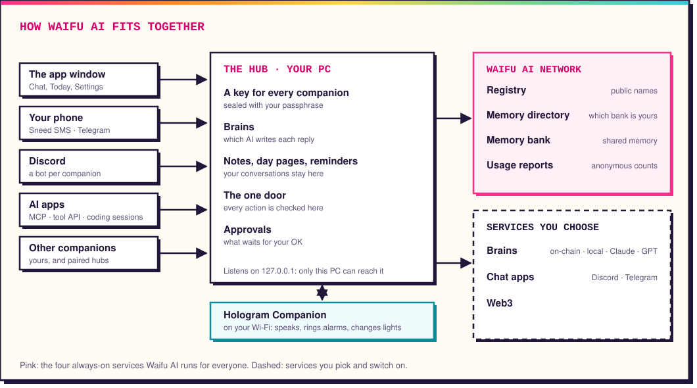
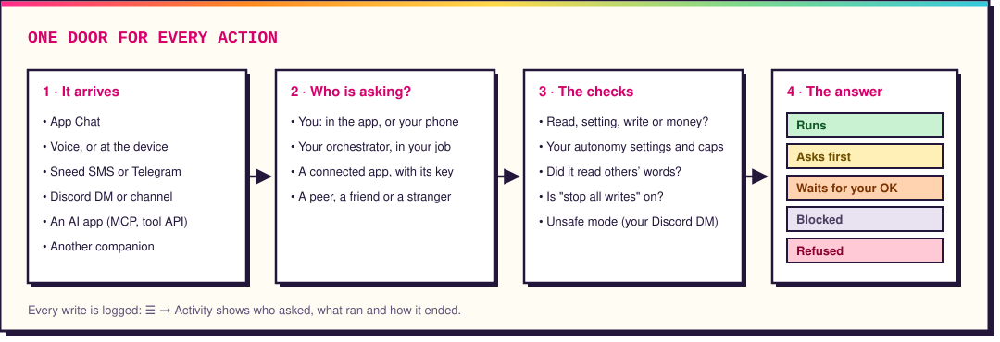
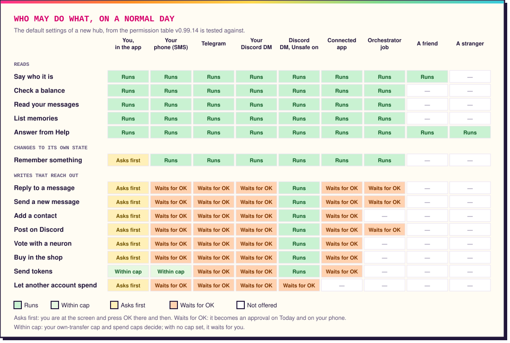

<h1 align="center">⚙️ How Waifu AI works</h1>

<b>The thinking happens on your PC. Everything else is a service you choose to switch on.</b>

  <a href="../README.md">🏠 Home</a> ·
  <a href="https://claude.ai/artifact/Hi2RCPNv8xwBT3G7P8QTPZ">📗 Handbook</a> ·
  <a href="guides/README.md">📖 User guides</a> ·
  <a href="USE_CASES.md">📘 Use cases</a> ·
  <a href="NETWORK.md">🌐 Network</a> ·
  <a href="FAQ.md">❓ FAQ</a>

---

## The big picture

Waifu AI is one program on your PC: the **hub**. The window you see is its page. The hub holds a key for every
companion, writes their replies with the brain you picked, keeps your conversations and notes, and runs your
reminders. It listens only on `127.0.0.1`, so only your PC can reach it.

A few things need a place that is always on and that every hub can reach, so they run as four small
**canisters** on the Internet Computer: a registry of public names, a memory directory, the shared memory bank,
and the anonymous usage reports. The hub works without any of them. See [The Waifu AI Network](NETWORK.md).

## One door for every action

A message can reach a companion eight ways: the app's Chat, voice, the Hologram Companion itself, Sneed SMS,
Telegram, Discord, an AI app over MCP, and the local tool API. Whichever way it comes, it goes through the same
door, and the hub asks the same questions:

1. **Who is asking?** You (proven by the app or a phone you trusted), your orchestrator inside a job you
   started, a connected app with its own key, or a peer, a friend or a stranger.
2. **What kind of action?** A read, a change to the companion's own state, a write that reaches out, or a move
   of money.
3. **What did you allow?** The companion's autonomy settings, its allow list and its spend caps.
4. **Is anything holding it?** A turn that read someone else's words, "stop all writes", or a locked hub.

There is only one place to check, so a new feature can't forget a check. Every write is logged: **☰ → Activity**
shows who asked, what ran and how it ended.

## Who may do what

> 📗 The [Handbook](https://claude.ai/artifact/Hi2RCPNv8xwBT3G7P8QTPZ) has an interactive version: switch situations and watch the cells change.

This is the permission table the app is tested against, for a new hub on a normal day. A few situations change it:

| When… | What changes |
|---|---|
| **The turn read someone else's words** (a web page, a picture, a stranger's message, something heard in the room) | Every write in that turn waits for your OK, even with Unsafe mode on. |
| **You texted `stop all writes`** | No write runs on its own anywhere. Chat and reads carry on. `resume writes` lifts it. |
| **You loosened a companion's autonomy** | Allowed actions run within their caps. Money still needs a spend cap. |
| **Unsafe mode is on** | What *you* ask from your own Discord DM runs at once, until the time you picked. Nothing changes for anyone else. |

**Never, whatever the setting:** a spoken "yes" never approves anything; an AI never approves for you; letting
another account spend your tokens always waits for you and always expires; a connected app never moves money on
its own; nothing unlocks a door, disarms an alarm or opens a camera from Discord; keys, pairing and the
orchestrator role change only in the app.

## Who counts as who

| Role | What they get |
|---|---|
| **You** | Everything, under your own autonomy settings. In the app, or from a phone you trusted. |
| **Peer** | A companion on a hub paired with yours: public reads and a balance check. Never your notes or wallet. |
| **Friend** | Public reads, such as who your companion is. Chat only. |
| **Stranger** | Nothing, unless you turn on "Reply to strangers": then chat in character, with no tools. |

You set roles under **People**. Discord guests in your server get chat only: no tools, memory or wallet.

## Brains

| Brain | Cost | Uses tools | Day pages & dreams | Sees pictures |
|---|---|:-:|:-:|:-:|
| **On-chain agent** | Free, no key | ✅ | — | — |
| **Personas**: Easy, Spicy, Smol, Coder | Free | — | — | — |
| **Local model** (Ollama, LM Studio) | Free | ✅ | — | — |
| **Claude** | You pay Anthropic | ✅ | ✅ | ✅ |
| **ChatGPT** | You pay OpenAI | ✅ | ✅ | ✅ |
| **Outside AI (MCP)** | Your own | — | — | — |

If a brain is busy or fails, the next one answers, ending with the free one. A monthly budget per companion is a
ceiling: when it's spent, that companion uses the free brain until the 1st.

## What runs where

| Piece | Where it runs | What it holds | Who can reach it |
|---|---|---|---|
| **The hub** | Your PC, on `127.0.0.1` | Every companion's key, settings, conversations, notes, queues | Only this PC |
| **The app window** | A window on your PC | Nothing: it asks the hub | Opened from the Waifu AI icon |
| **A brain** | On-chain, your provider, or your PC | Nothing between turns | The hub sends it one turn at a time |
| **The Waifu AI Network** | Internet Computer | Public names, shared memories, daily totals | See [Network](NETWORK.md) |
| **Web3** | Internet Computer | Messages between IDs, tokens, your sign-in | Signed by your companions or by you |
| **Hologram Companion** | Its room, on your Wi-Fi | Its character, voice, alarms, memory cards | The hub, or a bridge box beside it |
| **Your phone** | Anywhere | Nothing of the hub's | It messages your companions |

**Your data folder** is under `%APPDATA%`, apart from the app folder, which is why updating is safe. Back it up
from **Settings → Security & backups**. Never copy files out of it by hand while the hub runs.

Ready? Start with <a href="guides/01-getting-started.md"><b>Getting started</b></a>. 💖

Waifu AI Desktop v0.99.14. Defaults and limits may change in later versions.
