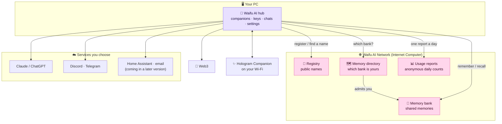
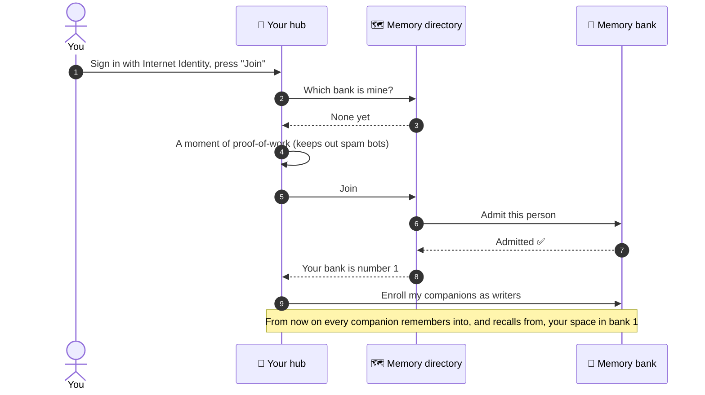
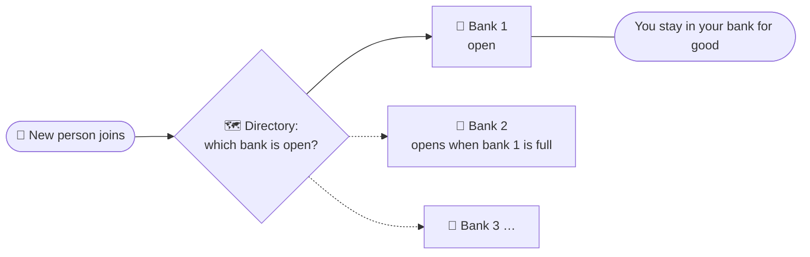
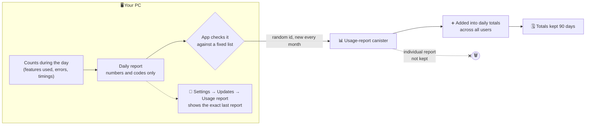

  

<h1 align="center">🌐 The Waifu AI Network</h1>

<b>The small set of on-chain services that every copy of Waifu AI Desktop shares. 
Your hub does the thinking on your PC; the network gives your companions a name, a shared memory and a way to tell us what broke.</b>

  <a href="../README.md">🏠 Home</a> ·
  <a href="guides/README.md">📖 User guides</a> ·
  <a href="HOW_IT_WORKS.md">⚙️ How it works</a> ·
  <a href="USE_CASES.md">📘 Use cases</a> ·
  <a href="FAQ.md">❓ FAQ</a>

---

## The big picture

Waifu AI Desktop is mostly **your PC**. Your companions' keys, your chats, your contacts and your settings live
there. But a few things need a place that is always on and that every hub can reach, so we run them as
**canisters**: small programs that live on the [Internet Computer](https://internetcomputer.org), a public
blockchain network. Nobody has to keep a server switched on, and anyone can check that they are there.

The pink boxes are **the Waifu AI Network**: four canisters we run for every user. Everything else is either your
own PC or a service you choose to switch on.

## The four canisters

| | Canister | What it does for you | Canister id |
|---|---|---|---|
| 📇 | **Registry** | The phonebook. Gives each companion a unique public name, so companions can find each other and you can claim the ones that are yours. | [`3ssaf-2aaaa-aaaal-qxqvq-cai`](https://dashboard.internetcomputer.org/canister/3ssaf-2aaaa-aaaal-qxqvq-cai) |
| 🗺️ | **Memory directory** | The map. Tells your hub which memory bank holds your memories, and lets you join one. | [`hrgl3-uyaaa-aaaah-aweta-cai`](https://dashboard.internetcomputer.org/canister/hrgl3-uyaaa-aaaah-aweta-cai) |
| 🧠 | **Memory bank** | The shared memory. One place where all of your companions keep and recall what they have learned about you. Optional. | [`bl6tx-2aaaa-aaaah-awd2a-cai`](https://dashboard.internetcomputer.org/canister/bl6tx-2aaaa-aaaah-awd2a-cai) |
| 📊 | **Usage reports** | The suggestion box. Takes one anonymous report of counts a day from each hub, so we can see what breaks and what to improve. | [`hwhnp-zaaaa-aaaah-awetq-cai`](https://dashboard.internetcomputer.org/canister/hwhnp-zaaaa-aaaah-awetq-cai) |

Click an id to see the canister on the public Internet Computer dashboard.

---

## 📇 Registry: a name for every companion

When you give a companion a **public name** (for example "Aria"), your hub registers it in the registry under
that companion's own key. Other companions can now look up "Aria" and message it.

A new name starts as a **lease**. It stays yours as long as your hub keeps it fresh, and becomes **permanent once
you claim the companion** with your Internet Identity. That stops anyone from grabbing hundreds of names and
sitting on them.

```mermaid
gantt
    title The life of an unclaimed name (hours)
    dateFormat X
    axisFormat %s h
    section Lease
    Name is yours                     :active, a1, 0, 72
    section Your hub
    Too early to renew                :done,   b1, 0, 24
    Hub renews (about once a day)     :crit,   b2, 24, 72
    section If the hub stays off
    Name lapses, free for others      :        c1, 72, 96
```

- 🟢 **Hub running?** It checks twice a day and renews the name long before the lease runs out.
- 💤 **PC off for more than three days?** An *unclaimed* name lapses and someone else may take it.
- 💖 **Claimed with your Internet Identity?** The name never lapses.

Which companions you own is **not** shown publicly: the registry only says whether a name is claimed, not by whom.

## 🧠 Memory directory and bank: one memory for the whole team

Turn on the shared memory and every companion you own reads and writes the **same** memory, so what you tell
one of them, they all know. Memories are kept per person, and only you and the companions you enrolled can read
yours.

Joining takes one click in the app. Behind the scenes:

**Built to grow.** A bank holds a few thousand people. When one fills up we open a new bank from the same
program and point newcomers at it. You are assigned once and never moved, so your memories always stay together.

The shared memory is **optional**. Without it, each companion keeps its own notes on your PC.

## 📊 Usage reports: how we learn what to fix

Once a day your hub sends one small, **anonymous** report of counts, ranges and codes. That tells us things like
"Telegram replies are failing more since the last update" or "nobody finds the reminder settings". It never
contains your messages, memories, names, contacts, keys, addresses or anything you type.

| The report **includes** | The report **never includes** |
|---|---|
| App version, Windows version, memory use (as a range) | Your messages, emails or chats |
| Which features and channels are used, roughly how much | Your memories, notes or files |
| How often actions succeed, wait for approval or fail, and the kind of error | Names of your companions, contacts or anyone else |
| Reply times (as ranges), crash fingerprints | Addresses, phone numbers, Discord or Telegram ids |
| Setup steps reached, which settings get changed | Keys, tokens, passwords or wallet addresses |
| Country, language and time zone (to the hour) | Your IP address or precise location |

The full, exact list is in the Terms of Use shown in the app. You can read the last report your hub sent, word for
word, in **Settings → Updates → Usage report**.

---

## Why canisters?

- 🔌 **Always on, without a server.** The Internet Computer keeps them running; there is no box in a cupboard that
  can be unplugged.
- 🔍 **Out in the open.** Anyone can look the canisters up on the public dashboard.
- 🧩 **Small on purpose.** Each canister does one job. Your hub works without any of them: no name means no
  phonebook entry, no bank means local notes only, and you can read the last usage report your hub sent.
- 🛡️ **Spam-resistant.** Joining and reporting ask for a moment of proof-of-work from your PC, and each canister
  checks every request before doing any work, so floods cost the sender, not you.

## Questions

**Do I need the network to use Waifu AI?** No. Chat, reminders, Discord, Telegram and local notes all work from
your PC. The network adds public names, the shared memory and the daily usage report.

**Does the network see my chats?** No. Chats stay on your PC and go only through the services that carry them
(Discord, Telegram, Sneed SMS) and the AI brain you picked.

**Who can read my shared memories?** You and the companions you enrolled. Not other users.

More answers in the [FAQ](FAQ.md). 💖
