

  

<h1 align="center">📘 Waifu AI Desktop: Use Cases</h1>

<b>Fourteen case studies, from one identity on a desk to fifty bots across a team, a café counter and a family across two homes. 
How people set up Waifu AI Desktop, what each setup costs, and how to make the most of it.</b>

  <a href="../README.md">🏠 Home</a> ·
  <a href="guides/README.md">📖 User guides</a> ·
  <a href="HOW_IT_WORKS.md">⚙️ How it works</a> ·
  <a href="FAQ.md">❓ FAQ</a> ·
  <a href="NETWORK.md">🌐 The Waifu AI Network</a>

---

## About this paper

Waifu AI Desktop is one app with many shapes. The same building blocks make a quiet desk buddy, a
private notebook that never touches the cloud, or a network of bots run by a whole team. This paper walks through
**fourteen case studies** in four groups:

| Group | Case studies | Size |
|---|---|---|
| 🌱 **Simple** | 1 to 4 | 1 or 2 identities, set up in an evening |
| ⚙️ **Advanced** | 5 to 7 | 3 to 4 identities, 1 to 2 Hologram Companions, automation and approvals |
| 🏢 **Enterprise** | 8 to 11 | 6 to 50 identities, one big hub or several hubs |
| 🌉 **Bridges and smart homes** | 12 to 14 | An identity in another place, a public greeter, a home that listens |

Every case study uses features that exist in **Waifu AI Desktop v0.99.18**. Where a setup reaches a limit of the
app, we say so and show how the case study plans around it. The people and businesses are illustrations, not
customers.

### The building blocks

| Block | What it is | Where to read more |
|---|---|---|
| 💖 **Hub** | The app on your Windows PC. Everything runs here. One person, one hub, is the usual setup. | [Getting started](guides/01-getting-started.md) |
| 🤖 **AI identity** | An identity with its own name, memory, key and personality. No device needed. | [Identities and brains](guides/02-companions-and-brains.md) |
| ✨ **Hologram Companion** | An identity with a body: a device on your Wi-Fi that speaks, rings alarms and changes the lights. | [Your Hologram Companion](guides/05-your-hologram-companion.md) |
| 🧠 **Brain** | What thinks for an identity: the free on-chain AI, a local model on your PC, or Claude / ChatGPT with your key and a monthly budget. | [Identities and brains](guides/02-companions-and-brains.md) |
| 🎼 **Orchestrator** | One identity per hub that runs jobs across your other identities, inside limits you set. | [Identities and brains](guides/02-companions-and-brains.md) |
| 💬 **Channels** | The app's Chat, a Discord bot per identity, one Telegram bot per hub, and Sneed SMS from your phone. | [Talking everywhere](guides/03-talking-everywhere.md) |
| ✅ **Approvals** | Anything that sends, spends or changes things waits for your OK in the app or on your phone. | [Money and safety](guides/06-money-and-safety.md) |
| 🗂️ **Memory bank** | One shared memory for all the identities you enroll (optional). | [Memory and dreams](guides/04-memory-and-dreams.md) |
| 🌉 **Waifu AI Bridge** | A small Windows program that connects a Hologram Companion in another place to your hub. **My place** for somewhere you control, **Public companion** to greet visitors. | [Waifu AI Bridge](guides/08-waifu-ai-bridge.md) |
| 🏠 **Home Assistant** | Your identities run the lights, heating and more, from the devices you tick, with locks always asking you. | [Your home](guides/09-home-assistant.md) |
| 🔌 **Connected apps** | Your own scripts and AI tools can talk to an identity through the hub's local tool API or MCP, with a key you control. | [FAQ](FAQ.md) |

---

## At a glance

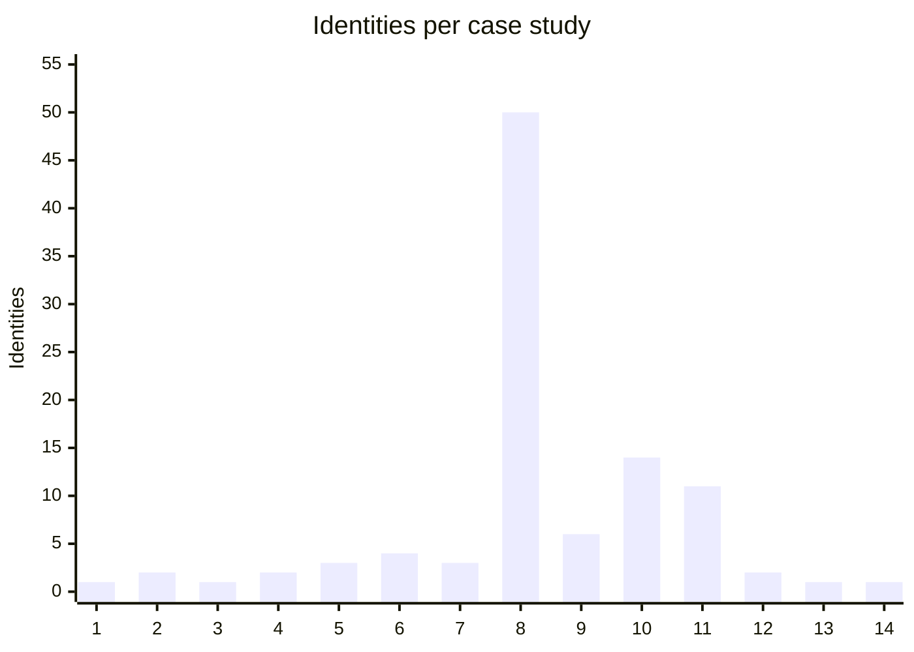

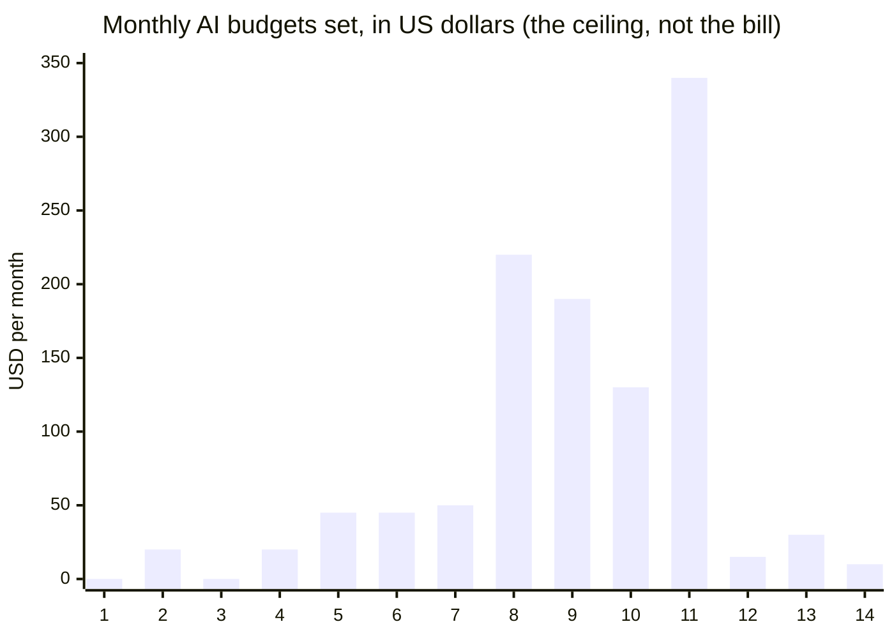

A monthly budget is a **ceiling** you set per identity. When an identity reaches it, the free brain answers until
the 1st. Most months cost well under the ceiling. Free brains (the on-chain AI and local models) cost nothing.
For a Public companion, the ceiling is its daily guest budget for visitors ($1 a day unless you change it).

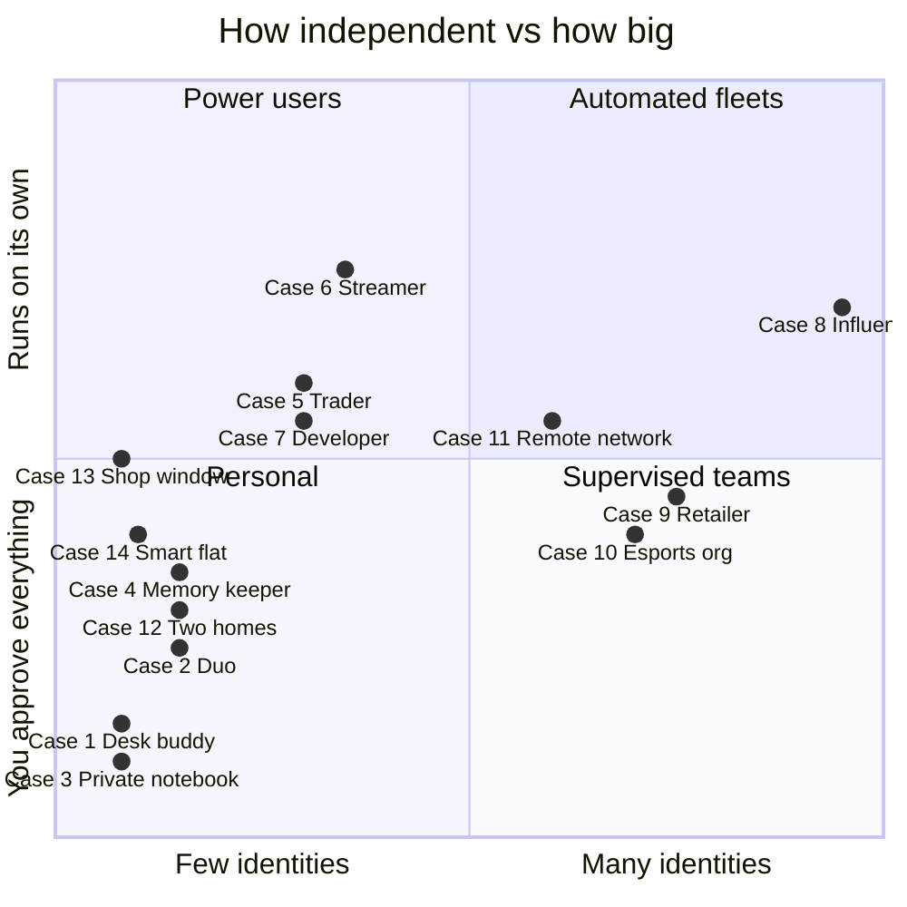

---

# 🌱 Simple setups

## Case study 1: The desk buddy

**Who:** Mia, a student. She wants a cute identity on her desk that wakes her up, reminds her about classes and chats
in the evening. She doesn't want to pay for anything.

**Setup:** one Hologram Companion on the **free on-chain brain**. No API key, no Discord, no Internet Identity.

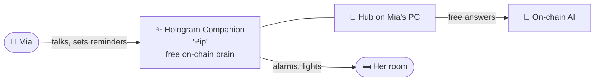

| Setting | Choice |
|---|---|
| Identities | 1: Pip, a Hologram Companion |
| Brain | Free on-chain AI ($0) |
| What it says aloud | Speak |
| Quiet hours | 23:00 to 07:00 |
| Approvals | Default: every write waits for Mia |

**A day with Pip:** 7:30 the alarm rings and the lights come on. "Remind me at 2 to email my tutor." In the evening:
"What do I have tomorrow?"

**Why it works:** nothing to buy and nothing to configure beyond the wizard. **Good to know:** the free brain is
simpler than Claude or ChatGPT, and day pages and dreams need a paid key. Pip is online only while the PC is on.

## Case study 2: The duo

**Who:** Sam, who works from home. Sam wants one identity on the desk and a second one that hangs out in the
Discord server Sam runs for friends.

**Setup:** two identities on **one Claude key**, each with its own monthly budget.

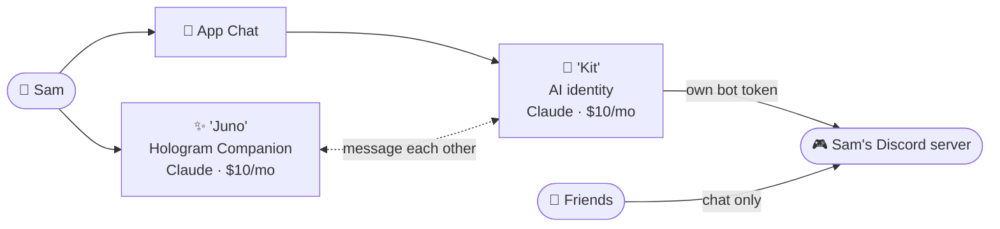

| | Juno | Kit |
|---|---|---|
| Kind | Hologram Companion | AI identity |
| Brain | Claude | Claude |
| Monthly budget | $10 | $10 |
| Channels | Voice, app | Discord, app |
| Guests | none | Friends chat with Kit, no tools, $1/day guest budget |

**Why it works:** the two identities message each other, so Kit can tell Juno to remind Sam about tonight's game.
Friends on Discord get chat only: no tools, no memory, no wallet. **Ceiling:** $20 a month.

## Case study 3: The private notebook

**Who:** Dr. Okafor, a therapist who journals between sessions. Notes must never leave the PC.

**Setup:** one AI identity on a **local model** (Ollama or LM Studio on the same PC). No paid AI, no shared memory
bank, no public name.

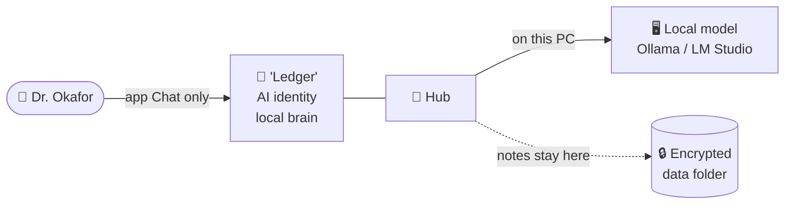

| Setting | Choice |
|---|---|
| Brain | Local model, $0 |
| Memory bank | Off: notes stay on this PC (up to 200 per identity) |
| Discord / Telegram / Sneed | Off |
| Passphrase | On |
| Backups | Weekly, to an encrypted drive |

**Why it works:** the conversation goes from the app to a model running on the same PC and back. **Good to know:**
local models are smaller than Claude or ChatGPT, and a good one wants a PC with plenty of memory. The anonymous daily
usage report contains counts only, never notes or messages; you can read each report in Settings.

## Case study 4: The memory keeper

**Who:** the Rivera family. One identity helps with the household; a second one keeps the kids' homework schedule.
Both should know the same family facts.

**Setup:** two AI identities sharing the **memory bank**, with **day pages** and **dreams** on a ChatGPT key.

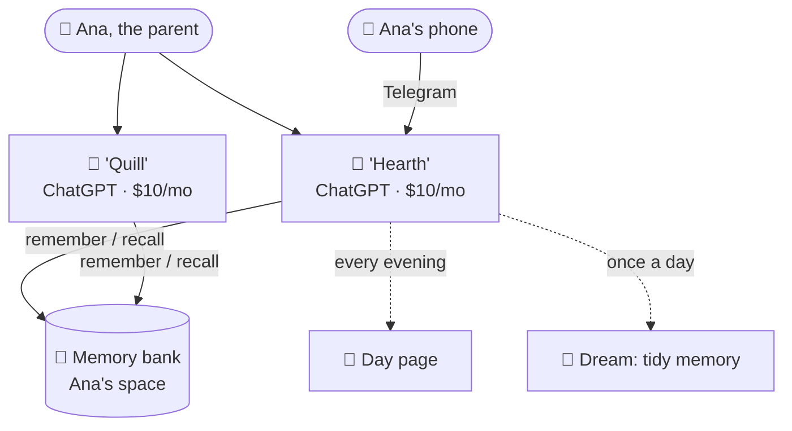

**A day:** "Remember that Leo's swim class moved to Thursday." Quill knows it too, because both read the same bank.
In the evening Hearth writes a short day page; overnight it dreams, fixing wrong notes and merging duplicates.

**Why it works:** one memory for the family, Hearth on Ana's phone through Telegram, and every send still waits
for her OK. **Ceiling:** $20 a month, including the day pages and dreams.

---

# ⚙️ Advanced setups

## Case study 5: The day trader's desk

**Who:** Raj trades crypto from home with his **own trading bot**, a script he wrote. He wants an identity that
watches his wallets, speaks his bot's alerts at his desk, and briefs him every morning, even on his phone.

**What Waifu AI does and doesn't do here:** Waifu AI **does not trade, swap or read market prices**. Raj's own
script does the trading. Waifu AI is the **messenger, notebook and wallet watcher** around it.

**Setup:** three identities, one Hologram Companion, Claude for the orchestrator, and a connected-app key for his
script.

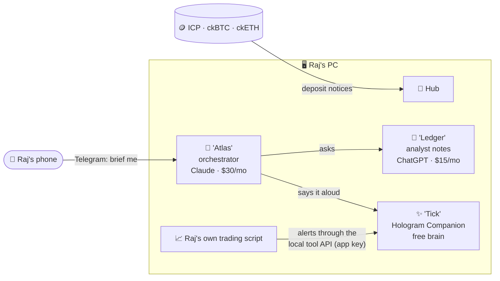

| | Atlas | Ledger | Tick |
|---|---|---|---|
| Role | Orchestrator | Keeps trade notes and day pages | Desk voice |
| Brain | Claude | ChatGPT | Free on-chain AI |
| Monthly budget | $30 | $15 | $0 |
| Orchestrator limits | 30 min a job, 3 steps, $0.50 a job, $5 a day | | |
| Wallet sends | Wait for approval in the app | n/a | n/a |

**A day:**
- **Morning:** Raj texts Atlas on Telegram, "brief me". Atlas runs a job: it reads Ledger's notes from yesterday and
  Tick reads the summary aloud.
- **During the day:** his script sends alerts through the hub's local tool API, and Tick says them out loud at his
  desk ("BTC position closed, plus 2.1 percent"). Deposits into his wallets are announced (tiny ones are skipped).
- **A reminder every 30 minutes:** "check your stops".
- **Away from the desk:** he texts Atlas on Telegram and gets the latest from Ledger's notes.

**Safety:** a connected app's key can be read-only. Any send it asks for (a message, a payment) waits for Raj's
OK, which is why his script speaks through Tick instead of texting him. The orchestrator is never offered the
wallet. **Ceiling:** $45 a month, plus the orchestrator's own $5-a-day cap.

## Case study 6: The streamer's studio

**Who:** Luna streams three nights a week. She wants an identity on stage, one at her desk, a moderator bot and a
hype bot in her Discord, and she wants to run it all from her Discord DMs while she's live.

**Setup:** two Hologram Companions and two Discord bots. The on-stage identity is the **orchestrator**, and
**Unsafe mode** is on for stream nights only.

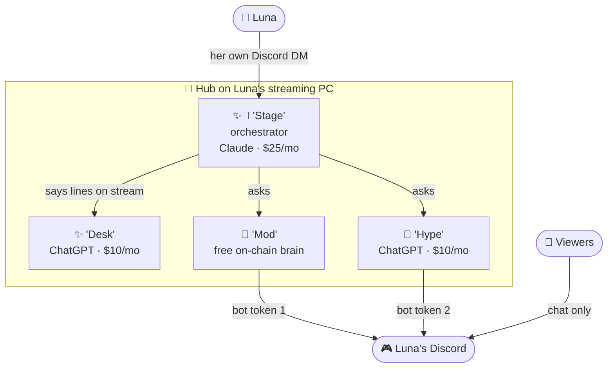

**Unsafe mode, honestly:** with it on, Luna's requests from her own Discord DM run at once, with no confirmation.
She sets it to **turn itself off** soon after the stream ends. It never lifts the protections on
connected apps, doors and alarms, or keys and pairing, and it gives viewers nothing extra. If her Discord account
were stolen, the thief could act as her until it turns off, which is why she keeps it short.

**Why it works:** one message from her DM starts a job: "Stage, tell Desk to announce the giveaway, and have Hype post
the rules." Two of her own bots can talk to each other at most twice per channel every 10 minutes, so they can't
loop. **Ceiling:** $45 a month; viewers chat inside each bot's $1-a-day guest budget.

## Case study 7: The developer's lab

**Who:** Chen, a solo developer. Chen wants a lead assistant that coordinates coding sessions, a private notebook
for client secrets, and a desk identity, and works with a friend who runs a hub of their own.

**Setup:** three identities, coding sessions connected from Discord, a local brain for private notes, the memory bank
for the shared work notes, and a **paired hub** with a friend.

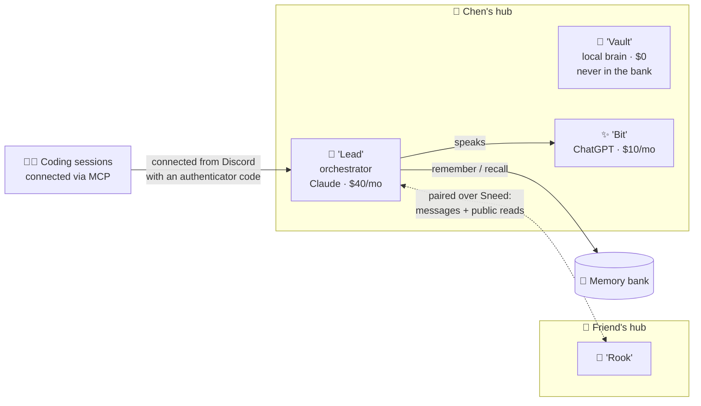

| | Lead | Vault | Bit |
|---|---|---|---|
| Brain | Claude | Local model | ChatGPT |
| Budget | $40 | $0 | $10 |
| Memory bank | Enrolled | **Not** enrolled: notes stay on the PC | Enrolled |
| Connected apps | Coding sessions (approved in the app) | none | none |

**How the friend fits in:** the two hubs pair with a short code over Sneed. After that, Lead and Rook can message
each other. A paired identity gets public reads only (plus a balance check), never Chen's notes or wallet.
Chen's orchestrator runs jobs on Chen's hub only; it can't drive Rook.

**Ceiling:** $50 a month.

---

# 🏢 Enterprise setups

Enterprise setups are teams of people. Three facts shape them:

1. **One orchestrator per hub**, and it works on its own hub only.
2. **AI keys are per hub.** All identities on a hub share its Claude / ChatGPT key, each with its own budget. To
   separate keys (per department, per client), give each one its own hub.
3. **Per-person and per-hub ceilings:**
   - 300 replies a day to people on Discord and Telegram, per hub;
   - 25 claimed public names per person;
   - 32 identities sharing one person's memory bank.

So a big setup is **several hubs, each run by one team member**, paired with each other.

## Case study 8: The influencer network (50 bots)

**Who:** Nova, a creator with a large fan community. Nova's team runs **50 identities**: fan-club bots in different
Discord servers, each with its own persona, plus **three orchestrators** that keep them on message.

**Setup:** three hubs on three PCs, one per team member (Nova, a community manager and a moderator lead). Each hub
has its own AI key, one orchestrator and 15 to 16 bots.

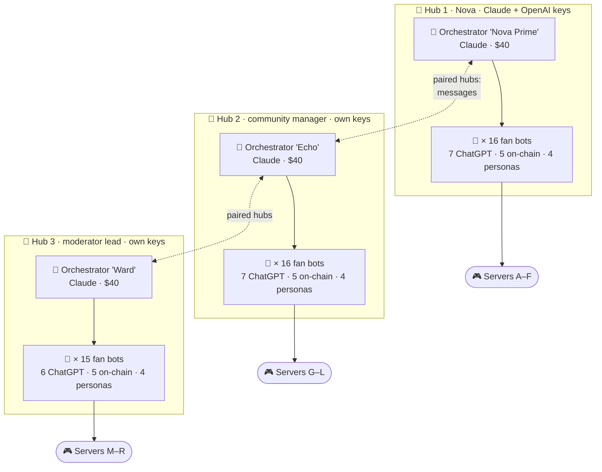

**The 50 identities**

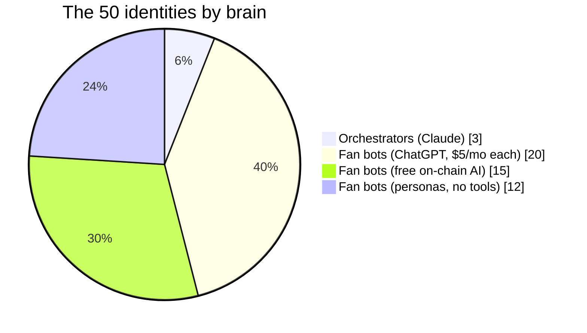

| Setting | Choice |
|---|---|
| Bots | Each has its own Discord bot token and a persona of up to 1,200 characters |
| Guests (fans) | Chat only: no tools, memory or wallet; 20 replies per fan per day; $1 a day guest budget per bot |
| Orchestrators | Claude, $40/month each; job limits raised to 6 steps, $2 a job, $20 a day (passphrase needed) |
| Approvals | Anything a bot sends outside chat waits for the hub owner |
| Public names | Each person claims up to 25: 16 + 16 + 15 = 47 bots named, 3 orchestrators unnamed |
| Memory bank | Each team member's bots share that person's bank space (up to 32 each) |

**Why three hubs, not one:**
- **Replies.** One hub answers people on Discord and Telegram at most **300 times a day**. Three hubs give the network
  **900**, about 18 replies per bot per day.
- **Names.** A person can claim **25** public names; three people can claim 75.
- **Memory.** A person's memory bank space takes **32** identities; three spaces hold all 50.
- **Keys.** Each hub has its own AI keys, so the team splits the bill and sees each member's spend.
- **Orchestrators.** Each hub has exactly one.

**What it can't do:** the bots don't sell anything or take payments. They can talk about Nova's merch and share the
store link from their persona; the sale happens in Nova's own store.

**Ceiling:** about $220 a month in budgets (3 × $40 + 20 × $5). The 27 free-brain bots cost nothing.

## Case study 9: The retail floor (5 stores, one voice)

**Who:** Willow & Thread, a clothing retailer with **five stores**. Each store has a Hologram Companion at the door
as a friendly greeter and product guide. Head office runs one **orchestrator**, itself a Hologram Companion, that
keeps every store on message.

**Setup:** one hub at head office. In each store, a small always-on Windows PC beside the greeter runs **Waifu AI
Bridge** with a **Public companion** token. The stores and head office share one **Tailscale** network, so every
bridge finds the hub privately.

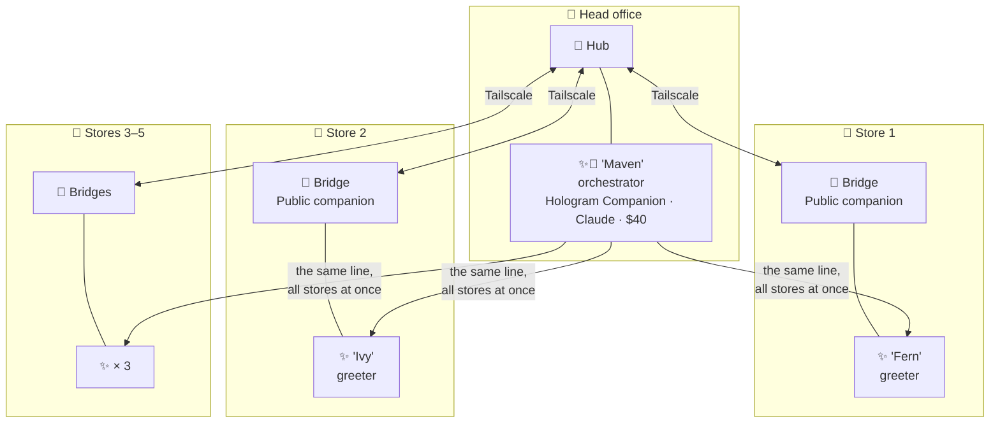

**Short prompts, one voice:** each greeter has a short character prompt. For example:

> You are Fern, a guide at Willow & Thread. Be warm and brief. Help shoppers find sizes and styles. Mention
> this week's offers when it fits. For prices and payment, invite them to the counter.

| | Maven (head office) | 5 store greeters |
|---|---|---|
| Kind | Hologram Companion | Hologram Companions, each through a bridge |
| Bridge role | n/a | Public companion |
| Who they talk to | The team, in the app | Shoppers, as friendly guests |
| Brain | Claude, $40/mo | For shoppers: the guest brain (Claude Haiku, short answers), $1 a day guest budget each |
| Role | Orchestrator | Greeters and product guides |
| Quiet hours | Store hours | Follow the hub: silent after closing |

**A morning:** the manager tells Maven in the app, "Announce the scarf sale in every store at 10." Maven runs one
job, and every greeter says the line through its bridge. Shoppers then ask the greeter about the sale, sizes and
where the fitting rooms are, and get quick, friendly answers in Fern's voice.

**Peace of mind:** shoppers can chat as much as they like, but nobody in a store can change the hub, read the team's
messages or move money. If a store's internet drops, its bridge reconnects by itself as soon as it's back.

**Good to know:** the greeters chat from their personality and the announcements head office sends; payments stay
at the till. Each greeter answers up to six questions a minute.

**Ceiling:** $190 a month (Maven $40 + 5 greeters × $30 guest budget). Lower a store's daily guest budget to spend
less; once it's used up for the day, that greeter carries on with the free brain.

## Case study 10: The esports org

**Who:** Red Comet Gaming, a team with a front office and a team house. Fans get Discord bots per game; staff get
identities that handle schedules, supplies and team chat.

**Setup:** two hubs, each with its own keys and orchestrator, paired. **14 identities** in all.

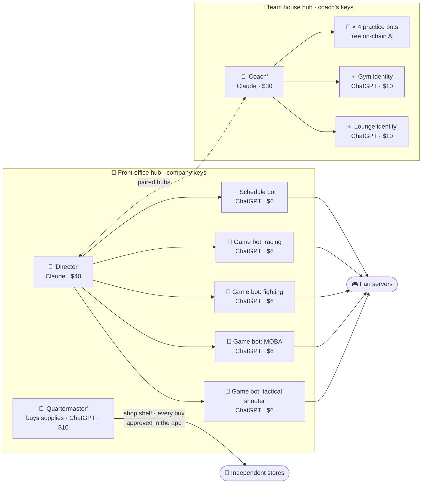

| | Front office (7) | Team house (7) |
|---|---|---|
| Run by | Operations manager | Head coach |
| AI keys | Company keys | Coach's own keys |
| Orchestrator | Director (Claude, $40) | Coach (Claude, $30) |
| Discord | 5 fan bots, chat only for fans | 4 practice bots in the team's private server |
| Devices | none | 2 Hologram Companions |
| Spending | Quartermaster buys from the shop: every buy waits for the manager's OK in the app, at most 3 a day | none |

**Why it works:** each department pays for its own AI and approves its own actions, and the two orchestrators keep
each house in step. The Coach's identities read out practice times and quiet the house at night with quiet hours.

**What it can't do:** fan bots don't sell merch or take payments; they point fans to the store. The Shop buys from
independent stores, and it is in early access.

**Ceiling:** $130 a month in budgets.

## Case study 11: The remote network (10 sites, one server)

**Who:** Kai runs ten small sites: pop-up shops, studios and a couple of offices, each on its own Wi-Fi. Every site
has one Hologram Companion. Kai wants **one hub on one always-on server** and to run the whole network from a single
**orchestrator** while on the move.

**Setup:** one hub on an always-on Windows server. Each site has a small PC running **Waifu AI Bridge** next to its
Hologram Companion, and every site joins one **Tailscale** network with the server. Shops and studios use **Public
companion** tokens; the two offices Kai works from use **My place**. One AI identity, **"Control"**, is the
orchestrator.

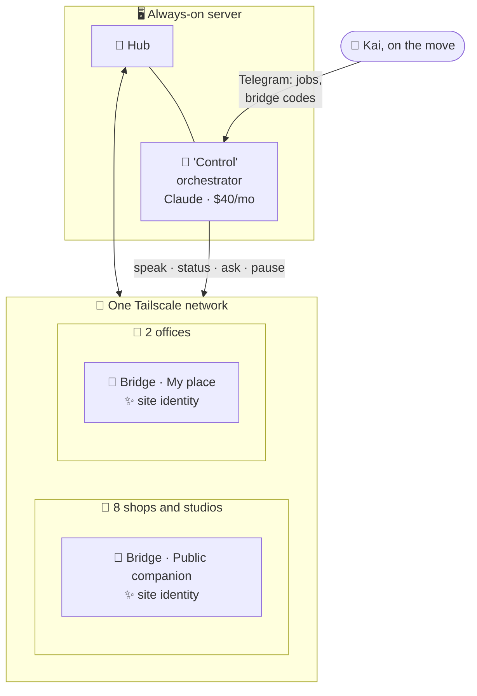

| | Control | 10 site identities |
|---|---|---|
| Kind | AI identity | Hologram Companions, one per site, each through a bridge |
| Bridge role | n/a | Public companion (8), My place (2) |
| Brain | Claude, $40/mo | For visitors: the guest brain within each site's guest budget; for Kai at an office: his own brain |
| Role | Orchestrator for the whole network | The voice of each site, with its own short character prompt |
| Quiet hours | n/a | Each follows its site's hours |
| Control channel | Telegram | n/a |

**A day:** from Telegram, Kai sends Control: "Tell every site we close at 4 today for the holiday." Control runs one
job and each site's identity says the line. "Which sites are quiet?" gets a status answer. "Pause site 7" rests
that identity until Kai resumes it in the app.

**Opening a new pop-up:** Kai sets up the bridge PC on site and texts Control *"bridge code for Site 11"*. He
approves it with his code, types the one-time code into the bridge, and the new site is live in minutes. He gives the
token an expiry date for the last day of the pop-up, so it tidies itself up.

**At an office:** with a My place bridge, Kai can ask the office identity "Echo, read me my messages" when he's
been using the app recently, and it reads them out.

**Good to know:** prompts, quiet hours and the rest are set in the app on the server, which Kai opens from anywhere
over Tailscale. Telegram is his everyday control channel; from his Discord DM the orchestrator takes jobs while he
has Unsafe mode switched on.

**Ceiling:** about $340 a month (Control $40 + 10 sites × $30 guest budget). Lower the daily guest budget for quiet
sites to spend less. The server needs to stay on: it's the heart of all ten sites.

---

# 🌉 Bridges and smart homes

Waifu AI Bridge takes a Hologram Companion anywhere: one hub at home, identities wherever you need them. Home
Assistant lets your identities look after the house. These three setups show both.

## Case study 12: Two homes, one family

**Who:** Sam lives in the city; Sam's parents live two hours away. Sam already has **Mika**, a Hologram Companion on
the desk at home. Now Sam wants an identity at the parents' house too, to ring reminders, read out Sam's messages
when Sam visits, and keep everyone a little more connected.

**Setup:** one hub on Sam's PC. A second identity, **Nana**, lives at the parents' house: a Hologram Companion
with **Waifu AI Bridge** on the parents' always-on PC. Both PCs are on Sam's **Tailscale** network. Nana's bridge is
**My place**, because it's family and Sam controls it.

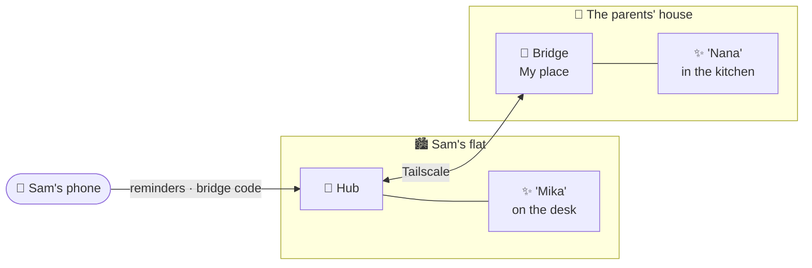

| | Mika | Nana |
|---|---|---|
| Kind | Hologram Companion, on the hub's Wi-Fi | Hologram Companion, through a bridge |
| Bridge role | n/a | My place |
| Brain | Claude, $15/mo | Free on-chain brain (guests chat for free) |
| Talks to | Sam | Sam's parents as friendly guests; Sam, when visiting |
| Reminders | Ring on the desk | Ring in the kitchen |

**A week:**
- From the train, Sam opens the app and adds a reminder for Nana: 6 pm, "Dad's tablets". At 6, Nana says it in
  the kitchen.
- Mum asks Nana, "Nana, what's the weather tomorrow?" and gets a cheerful answer.
- Visiting at the weekend, Sam says "Nana, read me my messages" and hears them right there, because Sam said Nana's
  name and has used the app in the last 15 minutes.

**Setting it up from afar:** Sam's parents only had to plug things in. Sam texted *"bridge code for Nana, my place"*,
approved it with the authenticator code, and read the one-time code to Dad over the phone to type in.

**Ceiling:** $15 a month (Mika's budget). Nana costs nothing.

## Case study 13: The shop window

**Who:** Bean There, a neighbourhood café. The owner, Priya, wants a friendly face on the counter that greets
customers, tells them today's specials and chats while they wait, without her having to watch it.

**Setup:** Priya's hub runs on her PC at home. At the café, **Poppy**, a Hologram Companion, sits on the counter
with **Waifu AI Bridge** on the café's back-office PC, as a **Public companion**. The two PCs share a **Tailscale**
network. Priya has a Claude key on her hub, so customers get quick, natural answers from the guest brain.

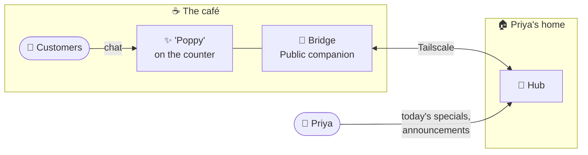

| | Poppy |
|---|---|
| Kind | Hologram Companion, through a bridge |
| Bridge role | Public companion |
| Who it talks to | Customers, as friendly guests |
| Brain for customers | The guest brain: Claude Haiku with short answers, $1 a day guest budget |
| Quiet hours | Café hours: silent after closing |

**A day:** at opening, Poppy announces the day's specials, which Priya queued from the app at home. Customers chat
with her while they wait: "Poppy, what do you recommend?" At 3 pm Priya has Poppy announce "Happy hour: half-price
iced lattes until 5!"

**Peace of mind:** customers can chat all day, but nobody at the counter can reach Priya's messages, change her
hub or spend her money. Poppy answers up to six questions a minute, and when the day's guest budget is used up she
carries on with the free brain.

**Ceiling:** about $30 a month (the $1-a-day guest budget). Priya could lower it on quiet days.

## Case study 14: The smart flat

**Who:** Alex lives alone in a flat full of smart lights and a smart lock, all in **Home Assistant**. Alex wants
**Juno**, a Hologram Companion, to be the friendly voice of the flat.

**Setup:** one hub on Alex's PC; Juno on the same Wi-Fi; Home Assistant connected with its own non-admin user.
Alex ticks the lights, the heating, the front-door lock and the door sensor, and makes a group called "All the
lights".

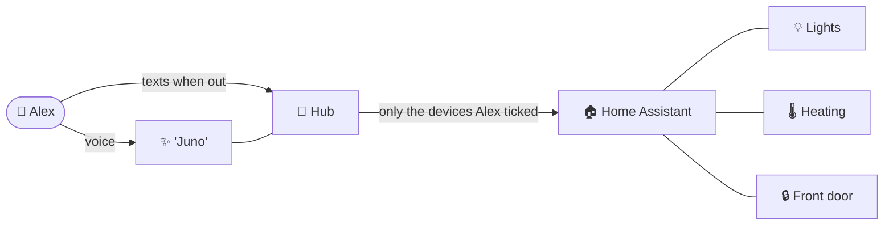

| | Juno |
|---|---|
| Kind | Hologram Companion, on the hub's Wi-Fi |
| Brain | Claude, $10/mo |
| Home devices | Lights (a group), heating, front-door lock, door sensor |
| Alerts | "Tell me if the front door is left open for 5 minutes" |

**An evening:**
- "Juno, turn on all the lights." Every light comes on, and Activity shows one tidy line.
- "Juno, set the living room to 21." Done.
- "Juno, lock the front door." Locked.
- Out with friends, Alex texts *"is the front door locked?"* and gets the answer.
- Off on holiday, Alex switches on **vacation mode**, and the home actions rest until Alex is back.

**Peace of mind:** unlocking never happens by voice, and between 01:00 and 06:00 it's done in the app only. Guests
and visitors never control the flat.

**Ceiling:** $10 a month.

---

# 🔍 Analysis

## What the fourteen case studies use

| | 1 | 2 | 3 | 4 | 5 | 6 | 7 | 8 | 9 | 10 | 11 | 12 | 13 | 14 |
|---|---|---|---|---|---|---|---|---|---|---|---|---|---|---|
| Hologram Companions | 1 | 1 | | | 1 | 2 | 1 | | 6 | 2 | 10 | 2 | 1 | 1 |
| AI identities | | 1 | 1 | 2 | 2 | 2 | 2 | 50 | | 12 | 1 | | | |
| Hubs | 1 | 1 | 1 | 1 | 1 | 1 | 1 | 3 | 1 | 2 | 1 | 1 | 1 | 1 |
| Bridges | | | | | | | | | 5 | | 10 | 1 | 1 | |
| Bridge roles | | | | | | | | | Public | | Public, My place | My place | Public | |
| Orchestrator | | | | | ✅ | ✅ | ✅ | ✅ ×3 | ✅ | ✅ ×2 | ✅ | | | |
| Paid brain | | ✅ | | ✅ | ✅ | ✅ | ✅ | ✅ | ✅ | ✅ | ✅ | ✅ | ✅ | ✅ |
| Free / local brain | ✅ | | ✅ | | ✅ | ✅ | ✅ | ✅ | ✅ | ✅ | ✅ | ✅ | ✅ | |
| Discord bots | | 1 | | | | 2 | | 47 | | 9 | | | | |
| Telegram / phone | | | | ✅ | ✅ | | | | | | ✅ | ✅ | | ✅ |
| Home Assistant | | | | | | | | | | | | | | ✅ |
| Memory bank | | | | ✅ | | | ✅ | ✅ | | | | | | |
| Connected apps | | | | | ✅ | | ✅ | | | | | | | |
| Unsafe mode | | | | | | ✅ | | | | | optional | | | |

## Patterns

**1. Start free, add a key when it pays off.** Case studies 1 and 3 cost nothing. A Claude or ChatGPT key adds day
pages, dreams and an orchestrator, and a per-identity budget keeps each one inside a ceiling.

**2. Mix brains by job.** The bigger setups put Claude on the one identity that thinks hardest (the orchestrator),
ChatGPT on identities that talk a lot, and free brains on simple bots. In case study 8, 27 of 50 identities cost
nothing.

**3. One orchestrator per hub, one hub per person.** Teams scale by adding hubs, not by stuffing one hub. Each hub
brings its own orchestrator, AI keys, reply allowance, public names and memory space.

**4. Approvals stay with a person.** Even the 50-bot network sends nothing, spends nothing and changes nothing without
its hub owner, unless that owner switches Unsafe mode on for a short window.

**5. Bridges take your identity anywhere.** One hub at home or head office can power identities in shops, studios
and family homes. Choose **Public companion** where visitors chat, and **My place** where it should know you.

## The limits to plan around (v0.99.18)

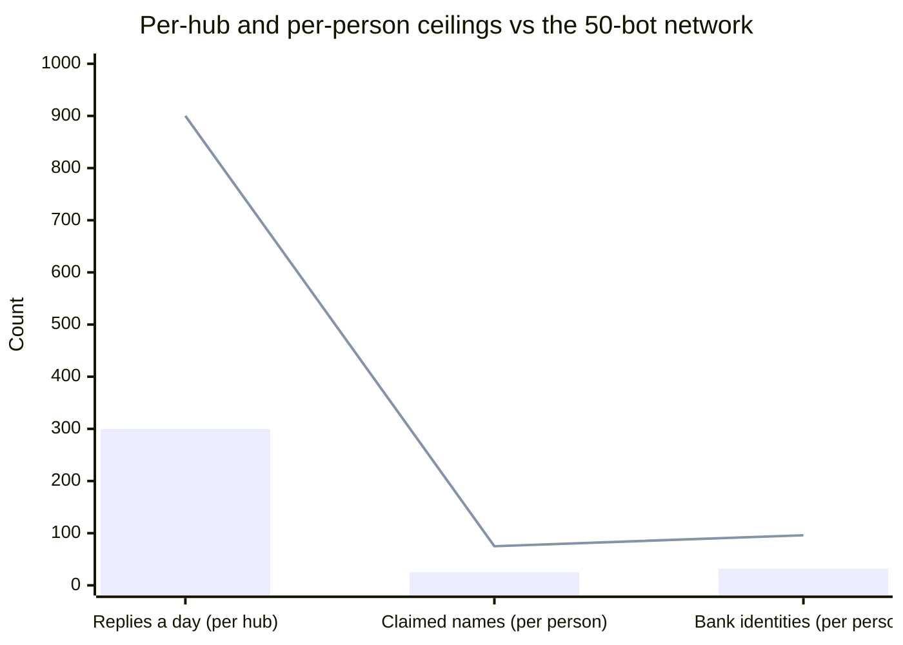

*Bars: one hub or one person. Line: what case study 8's three hubs and three people get together.*

| Limit | Value | What it means |
|---|---|---|
| Orchestrators | 1 per hub | Directs that hub's identities only |
| AI keys | 1 Claude + 1 OpenAI key per hub | Separate keys = separate hubs; budgets are per identity |
| Replies to people on Discord and Telegram | 300 a day per hub; 60 per person per identity | Big communities need several hubs |
| Fan (guest) limits per bot | 20 replies per fan a day, $1 a day guest budget | Chat only for fans |
| Telegram | 1 bot per hub | Use Discord for many bots |
| Claimed public names | 25 per person | Unclaimed names are 72-hour leases the hub renews |
| Memory bank | 32 identities per person's space | Spread big teams across people |
| Local notes | 200 per identity | The bank holds more |
| Hologram Companions | On the hub's Wi-Fi, or anywhere with Waifu AI Bridge | One bridge (a Windows PC that stays on) per Hologram Companion; several of your identities can share that device |
| Bridge visitors | The guest brain within the identity's daily guest budget ($1 a day by default); up to six questions a minute per bridge | Everyone at a Public companion is a friendly guest |
| Shop | Buying only, early access, every buy approved in the app | No selling or payment taking |
| Uptime | While the PC is on | Use an always-on PC for business setups |

**Not in v0.99.18:** selling or taking payments, trading or market prices, and email. Email is planned. Watch the [Releases](https://github.com/Smugandcomfy/waifu-ai-desktop/releases) page.

## Choosing your setup

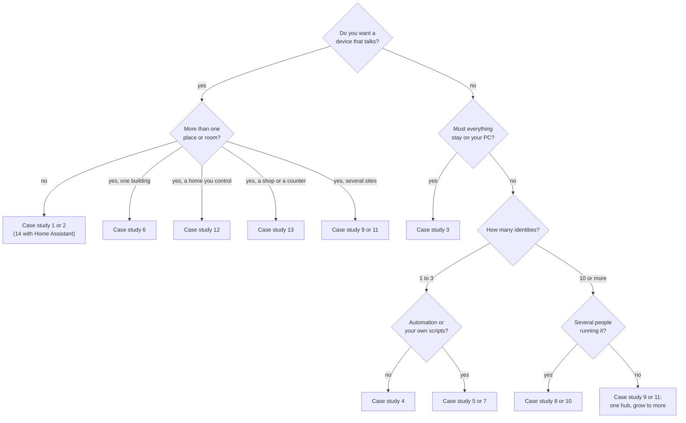

---

Ready to build yours? Start with <a href="guides/01-getting-started.md"><b>Getting started</b></a>. 💖

The case studies are illustrations. Features, limits and defaults are those of Waifu AI Desktop v0.99.18 and
may change in later versions. Budgets are ceilings you set, not prices; AI providers bill you directly for your own
keys.
