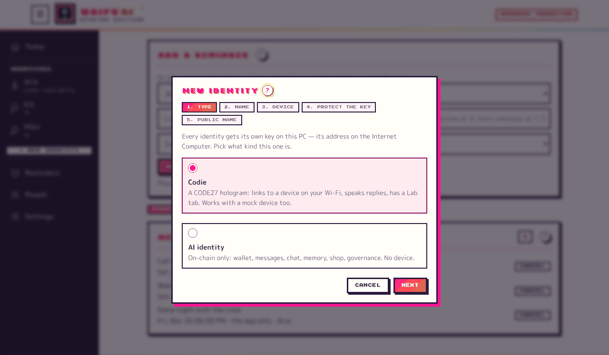
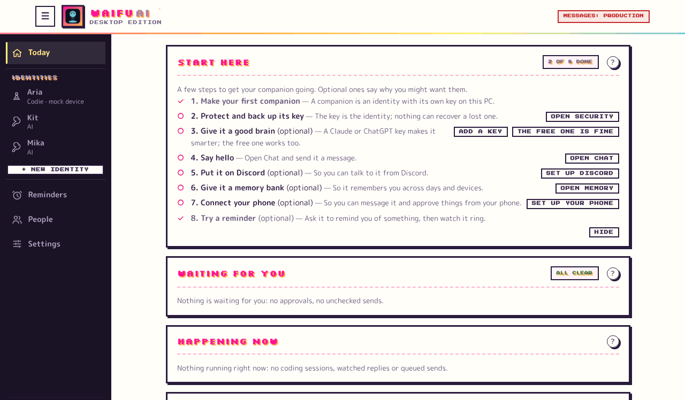

# 01 · Getting started

📖 <a href="README.md">All guides</a> · Guide 1 of 9 · <a href="../../README.md">Home</a>

From download to your first "hello" in about five minutes. ✨

## You'll need

- A Windows PC, 64-bit (x64), connected to the internet.
- About 100 MB of space.
- A name for your first identity. That's it: no account, no money, no device.

## 1. Download and unzip

1. Open the [latest release](../../../../releases/latest) and download `waifu-ai-vX.Y.Z-win-x64.zip`.
2. Unzip it into a folder you'll keep, for example `Documents\Waifu AI`. Don't run it from Downloads: the app
   runs from this folder.

There's no installer. Inside the folder you'll find `Waifu AI.exe` (the app), its licence and notices, and a
`ui` folder (the app's pages).

## 2. Start it

1. Double-click **`Waifu AI.exe`**.
2. If Windows shows a blue **"Windows protected your PC"** box: click **More info → Run anyway**. It appears
   because the app isn't code-signed yet and came from the internet.
3. Waifu AI opens. The first time, it shows its **Terms of Use**: read them and press **I accept**. (You can
   reread them any time in **Settings → Updates → Terms**.)

**Desktop icon (optional):** right-click `Waifu AI.exe` → **Send to → Desktop (create shortcut)**.

## 3. Find your way around

The column on the left has the main places, with your identities in the middle:

- **Today**: what needs you, what's happening now, what's coming up, and what to fix.
- **Identities**: your identities, one row each, with a status word and a badge when something waits.
  **+ New identity** sits under the list. Click an identity to open its page.
- **Reminders**: everything you asked to be reminded of.
- **People**: your contacts and the public directory.
- **Settings**: nine tabs, from **You & account** to **Appearance**.

Each identity's page has its own tabs: **Overview**, **Conversations** (Chat, Messages, Discord, Phone),
**Memory**, **Behaviour**, **Device** (Hologram Companion only), **Connections**, **Money** (Advanced) and
**Manage**. Clicking another identity keeps the tab you were on.

At the foot of the column is the status light (**Live**, **Degraded** or **Offline**). The **☰** menu at the
top left holds the hub's tools: the **Simple | Advanced** switch, **Activity** (everything the hub did),
**Help**, **Appearance**, **Desktop pop-ups**, **Your account** and, last, **Quit**.

On a phone-sized window, a bar of four sits at the bottom and the button under the title picks an identity.

Tip: every card has a **?** that opens help for exactly that card.

## 4. Make your first identity

1. On Today, press **Create your first identity** (later: **+ New identity** under your identities in the
   left column).
2. **Type**: pick one.
   - **Hologram Companion**: speaks its replies on the hologram device. No device yet? No problem: it starts
     as a practice ("mock") device that shows what it would say as text, and you can connect the real one
     later.
   - **AI identity**: no device. It chats, messages, remembers and can go on Discord all the same.

   Not sure? Pick the Hologram Companion with the practice device. It can do everything an AI identity can.
3. **Name**: what you'll call it on this PC, like "Aria". You can rename it later.
4. **Device** (Hologram Companion only): pick **Mock device** for now, or the real device if yours is on this
   Wi-Fi (see [Your Hologram Companion](05-your-hologram-companion.md)).
5. **Protect the key**: press **Set a passphrase**, type a long one twice (four or more words works well), and
   write it down somewhere safe. There's no way to recover a forgotten passphrase.
6. **Brain** (AI identity only): the **Free on-chain agent** is fine to start. You can change it any time on
   its **Behaviour** tab.
7. **Public name**: press **Skip for now**. You can add one later; chatting doesn't need it.

Your identity's page opens, with a short **Finish setting up** list on its Overview (it shows only the steps
that are left). Closed the window halfway? Nothing's lost: press **Resume setting up** (or **New identity** asks
whether to resume). Nothing is ever created twice.

## 5. Say hello

1. Click your identity in the left column.
2. Open its **Conversations** tab. It opens on **Chat**.
3. Type "Hi! What can you do?" and press **Send**.

It answers with the free on-chain brain. Now try a reminder: "remind me in 2 minutes to stretch". ⏰

## 6. Back it up (please!)

An identity **is** its key. Lose the key with no backup, and that identity is gone for good.

1. Open **Settings → Security & backups → Keys**.
2. Press **Back up keys**, choose a passphrase for the backup file, and save it somewhere that isn't this PC
   (a USB stick, or a synced folder).

Do it again each time you make a new identity. More in [Money and safety](06-money-and-safety.md).

## What next?

- Give it a smarter brain: [Identities and brains](02-companions-and-brains.md).
- Put it on Discord, Telegram or your phone: [Talking everywhere](03-talking-everywhere.md).
- Let it remember: [Memory and dreams](04-memory-and-dreams.md).

**Make it yours:** **Settings → Appearance → Theme** has six looks: Kawaii (the default), Kawaii Night,
Daylight, Sandstone, Slate and Midnight.

---

<a href="../../README.md">← Main page</a> · <a href="README.md">All guides</a> · <a href="02-companions-and-brains.md">Identities and brains →</a>

