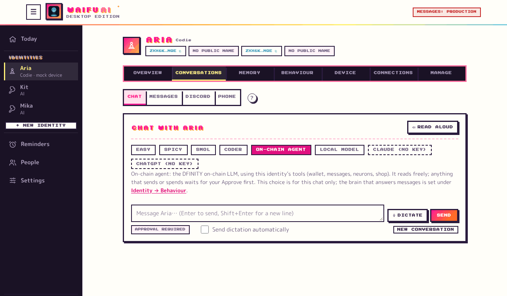
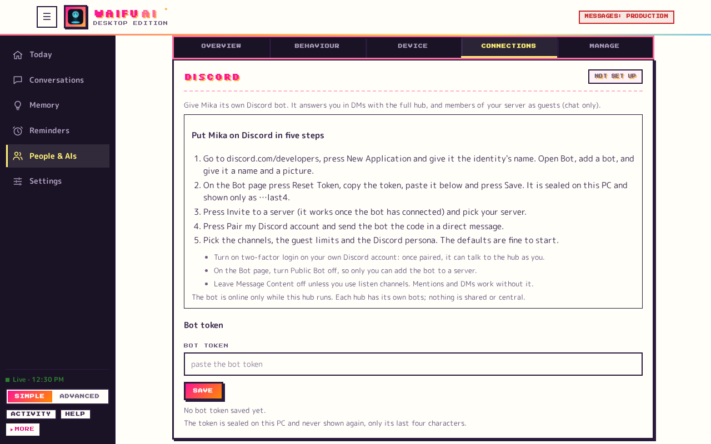
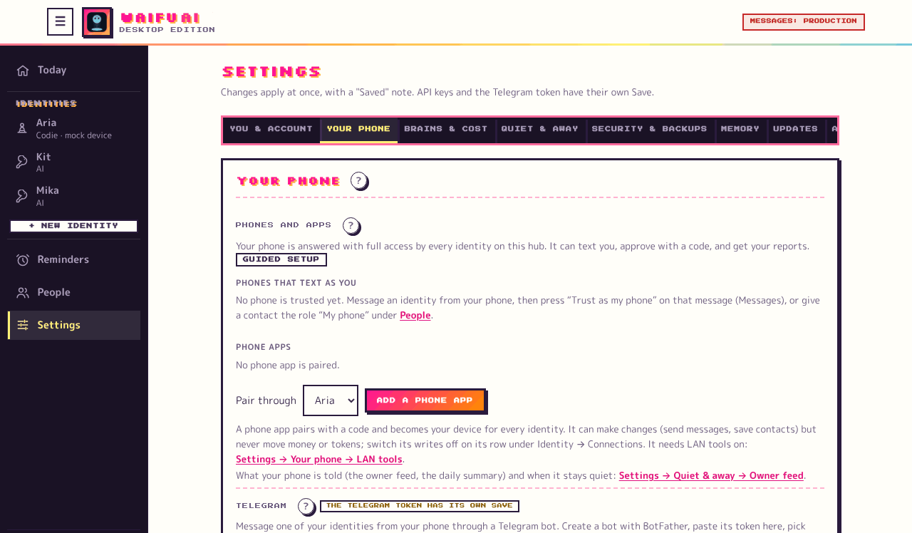

# 03 · Talking everywhere

📖 <a href="README.md">All guides</a> · Guide 3 of 9 · <a href="../../README.md">Home</a>

In the app, on Discord, on Telegram or from your phone: your companion is the same everywhere, and it asks you
before it does anything big. 💬

Each companion's **Conversations** tab has a sub-tab for each place: **Chat** (here in the app), **Messages**
(its Sneed SMS mailbox and any sends queued to go out), **Discord** and **Phone** (Telegram and texts from your
phone). Long threads show a page at a time, with **Earlier** or **Show more** for the rest.

## Chat in the app

1. Click your companion in the left column and open its **Conversations** tab (it opens on **Chat**).
2. Pick a brain chip above the box (the first free one is fine).
3. Type and press **Send**. **Stop generating** stops a reply mid-way; your draft is kept if you leave.

**Change settings by asking.** "Rename yourself to Aria", "quiet hours 23 to 7", "set my time zone to
Toronto", "use claude", "what are my settings?". Small things happen at once; bigger ones (the brain, its
budget, its public name) wait for your yes; and keys, backups, security and payments are changed in the app
only (it tells you where).

## Approvals: you stay in charge ✅

Anything that sends a message, sends tokens, votes, buys or changes settings **waits for your OK**, unless you
allowed it. You'll see it:

- on **Today → Waiting for you**, for every companion;
- as a count on the companion's Overview, with **Open Today** to see just that companion's;
- right in Chat, under the reply.

Press **Approve** to run it once, or **Don't** to drop it. What you approve is exactly what is sent: an
approval shows the whole text and who it really goes to. Unanswered approvals expire after a week.

From your phone: reply **yes** within 10 minutes, or text `pending` and then `yes 2` / `no 2`.

### What it does on its own

**Behaviour → Actions & autonomy** has three sub-tabs: **Level**, **What it may do** and **History**. **Level**
sets two things:

- **On a new message**: **Off** (it only acts when you ask; the default), **Propose** (it suggests and waits
  for your OK), or **Auto** (it runs the actions you allowed, within caps you set).
- **When you're using it**: **Approval required for every write** (the default), **Allowed actions run
  automatically, the rest wait**, or **All actions run automatically**.

A new companion starts with nothing allowed on its own. Sending tokens is never automatic until you add it and
set a spend cap, and buying always waits for you. **Starter profiles** (Conversation only, Remember and share,
Assisted actions) set these in one go, show exactly what will change, and have **Undo**. **Try this sentence**
shows who would answer a message and whether it would need your OK, without sending anything.

Two handy switches on the same card: **Answer my phone even when autonomy is off**, and **Reply to strangers
(in character, no tools)**, which is off for a new companion.

## Discord 🎮

Your companion can have its own Discord bot. In your server it chats with your members; in a private message
(DM) with you, it's your whole hub.

**You'll need:** a Discord account (turn on two-factor login), a Discord server you own (in Discord: **+** →
**Create My Own**; it's free), and Waifu AI running on this PC.

The Discord card on the companion's **Connections** tab has four sub-tabs: **Set up**, **Where it answers**,
**You & guests** and **Persona**.

**The easy way:** **Connections → Discord → Set up → Guided setup** walks you through every step and checks each
one.

**By hand:**

1. Go to discord.com/developers, press **New Application**, name it after your companion, press **Create**.
2. Open **Bot**. Add a picture if you like. Turn **Public Bot** off. Leave **Message Content** off.
3. Press **Reset Token**, confirm, and **Copy**. Never share this token.
4. In Waifu AI, on **Connections → Discord → Set up**, paste it under **Bot token** and press **Save**, then
   **Test**.
5. Press **Invite to a server**, pick your server and press **Authorize**.
6. Under **To finish setting up**, press **Add this server** (or **allow #channel**).
7. On **You & guests**, press **Pair my Discord account** and send the bot the `pair …` line it shows, in a DM.
   Now it knows you're you.

**Good to know:**

- In a channel it answers when mentioned (or answers everything in a **listen** channel, which needs Message
  Content switched on in the Developer Portal). Channels are set on **Where it answers**.
- Everyone else in your server is a **guest**: chat only, no tools, no memory, no wallet. **Guest limits** (on
  **You & guests**) caps their daily cost (default $1.00 a day).
- On Discord, anything more than a simple setting (a message, a post, a vote, a reminder, a payment) waits for
  your OK **in the app or on your phone**. "yes" on Discord never approves it (unless you turned on
  [Unsafe mode](#unsafe-mode-your-discord-dm-with-no-brakes-)).
- A coding session asking to connect to your companion can be approved from your own Discord DM: reply
  `connect` followed by the request's code and the 6-digit code your authenticator app shows now. It works only
  in your DM, once per request, and needs an authenticator set up in **Settings → Security & backups → Task
  approvals** (Advanced; it needs a passphrase). Telegram can't do this.
- Money asked for in a server channel moves to your DM.
- Send the bot a picture and a Claude or ChatGPT brain can look at it. Pictures are never saved.
- The bot is online only while Waifu AI runs.

## Unsafe mode: your Discord DM with no brakes ⚠️

Normally, anything big you ask on Discord waits for your OK in the app or on your phone. **Unsafe mode** lifts
that, for **you** only: what you ask from your own Discord DM runs at once, with **no confirmation**. Messages,
settings and **money** included. So do the orchestrator's jobs for you. It's handy when you're away from your PC
and trust your Discord account. It's also exactly as risky as it sounds: anyone who gets into your Discord
account can then act as you.

**Turn it on** (only in the app): **Settings → Security & backups → Unsafe mode**. Read both lists ("What it
lifts" and "What it never lifts"), choose **Turn it off by itself** (after 1 hour up to 7 days, or until you turn
it off), and press **Turn Unsafe mode on…**. It asks for your passphrase, or shows a Yes/No window on this PC.
You can also list Discord channels it covers, but private things (your messages, notes, balances) still answer
only in your DM.

**What it never lifts:**

- connected AI apps and devices still always ask;
- anything that read someone else's words (a web page, an email, a forwarded message, someone else's post) still
  waits for your OK;
- doors and alarms: no unlocking, disarming, opening a garage or a camera from Discord;
- nobody else gains anything: guests, friends, strangers and your other companions are treated as before;
- keys, pairing and the orchestrator role stay in the app.

**While it's on**, a red banner sits on every page, Today has a line about it, and **Activity** tags everything it
let run as **unsafe mode**. Your phone and Discord DM are told when it goes on and when it ends.

**Turn it off from anywhere:** the banner's **Turn it off**, **Turn Unsafe mode off** in Settings, a text or
Discord DM saying `unsafe off`, `stop all writes`, or the auto-off time. Turning it off never needs a passphrase.

## Telegram 📱

The easiest way to text a companion from your phone, with no send limits.

**Settings → Your phone → Telegram** has a **Guided setup**. Or by hand:

1. In Telegram, open **BotFather**, send `/newbot` and answer its questions. Copy the token.
2. In Waifu AI, open **Settings → Your phone → Telegram**, paste the token and press **Save token**.
3. Pick the **Identity that answers** and press **Test**.
4. From your phone, message the bot. It says it doesn't know you yet.
5. Back in Waifu AI, under **Waiting**, press **Trust this chat**.

Done: that chat is now you. Strangers who find your bot get one polite sentence and nothing else. One Telegram
bot per hub.

## Your phone, over Sneed SMS

Sneed SMS is a messaging service on the Internet Computer that your companions use as their mailbox. You can
write to them from Sneed Hub on your phone, signed in with Internet Identity.

1. From your phone, send one of your companions a Sneed message (to its principal).
2. In Waifu AI, open that companion's **Conversations → Messages**.
3. On that message, press **Trust as my phone**.

Your phone is now an **owner device**: every companion answers it with full access, and it can approve things.
**Settings → Your phone → Phones and apps → Guided setup** does this with you.

⚠️ Sneed messages are **not encrypted**: treat them like postcards. Each sender can send one every 10 minutes
(Sneed Premium allows one a minute). Messages between your own companions stay inside the hub and skip the
limit.

### Texts your phone understands

| Text | What it does |
|---|---|
| `pending`, then `yes 2` / `no 2` | Answer what's waiting for you |
| `yes` / `no` | Answer the one thing asked in the last 10 minutes |
| `remind me at 7 to call mum` | Set a reminder |
| `vacation on` / `vacation off` | Nobody acts on anything while you're away |
| `pause Aria` / `resume Aria` | Stop or restart one companion acting on its own |
| `stop all writes` / `resume writes` | The emergency brake for the whole hub |
| `unsafe off` | Turn Unsafe mode off (it also works in your Discord DM) |
| `run a dream` / `did the dream work?` | Tidy the memory now, or hear how the last one went |
| `forget former names` | Let go of old names after a rename |
| `help` | The list |

A sentence that only *contains* a command word is just talk: "don't pause Aria" pauses nothing.

**What your phone is told:** **Settings → Quiet & away** has quiet hours, vacation mode, a morning callback and
the **owner feed** (a short digest of what your companions did, off until you switch it on; its **Sent to you
lately** fold shows the newest 30 lines).

## When your companions talk to each other

Send one a message as another (or just ask: "ask Mika what she thinks"). The other answers in its own voice,
using the shared memory. Between companions on the same hub a turn takes seconds. They stop by themselves when
only goodbyes are left, and after 8 replies each, so two chatty AIs can't run up your bill.

---

<a href="02-companions-and-brains.md">← Companions and brains</a> · <a href="README.md">All guides</a> · <a href="04-memory-and-dreams.md">Memory and dreams →</a>

