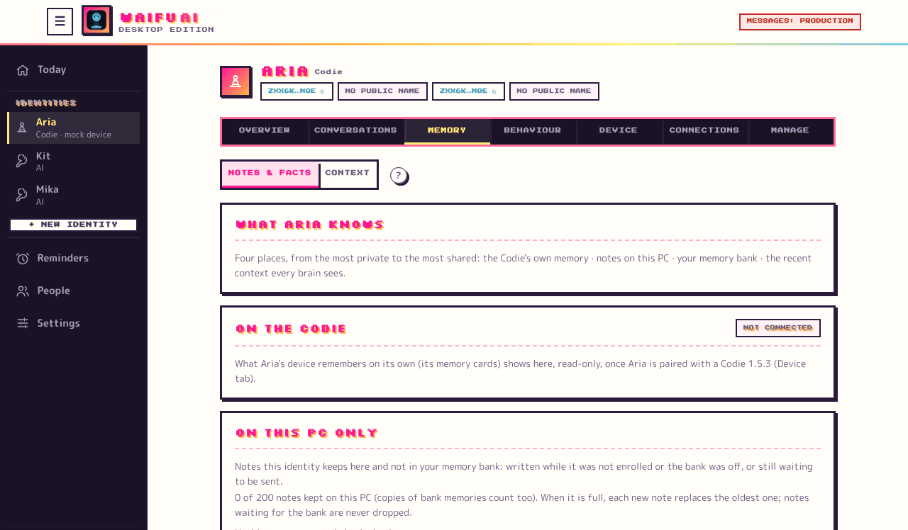
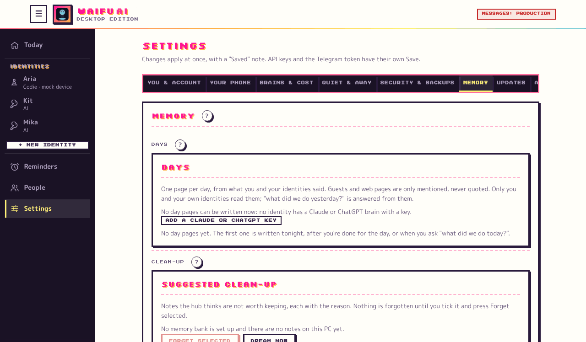

# 04 · Memory, dreams and reminders

📖 <a href="README.md">All guides</a> · Guide 4 of 7 · <a href="../../README.md">Home</a>

Your companions remember what you tell them and what you do together. It works from day one with nothing to
set up. 🌙

## How memory works

A companion's memory lives in up to four places, from closest to widest:

1. **On the hologram device**: a real Hologram Companion keeps a few memory cards of its own. You can read them
   in the app.
2. **Notes on this PC**: what each companion learns ("remember that…", facts from conversations, summaries).
   This always works, bank or no bank.
3. **The memory bank** (optional): one shared memory on the Internet Computer. What you tell one companion,
   the others know too.
4. **Context**: the last few turns of all your conversations, which every brain reads, so one companion can
   pick up where another left off.

## Teach it something

Just say it: "Remember that my sister's name is Ana."

Companions also pick up lasting facts (people, preferences, plans) as you chat, and a quiet conversation is
summed up into one memory.

To see what a companion knows: click it in the left column, open its **Memory** tab, and look at **Notes &
facts** (**Context** shows the last few turns every brain reads). On any memory, **Why?** shows where it came
from, **Correct** fixes it and **Forget** removes it. Long lists show a page at a time, with a button for more.

## Days: "what did we do yesterday?"

1. Talk with your companions during the day.
2. When you're done for the day (in the evening, half an hour after the last message), a short **day page** is
   written. On Sunday night, a **week page** too.
3. Ask "what did we do yesterday?" or "what happened last week?". "What do you remember from Monday?" reads
   that day's page to you.

**Settings → Memory → Days** lists the last 14 pages (they cover the whole hub, so they live in Settings).
**Rebuild** writes one again, **Correct** lets you fix it in your own words, and **Forget** removes it. A day
page is read only for you, never for guests or friends.

Day pages need a **Claude or ChatGPT key** (see [Companions and brains](02-companions-and-brains.md)). Without
one, your companion still remembers what you tell it; it just doesn't write day pages or dream.

## Dreaming 💤

Once a day, after your day ends, one companion with a Claude or ChatGPT key "dreams": it rereads the day's
conversations and tidies the memory. It fixes notes that turned out wrong, merges duplicates, lets small old
notes sink, and keeps one short page per person.

1. Add a Claude or ChatGPT key in **Settings → Brains & cost → AI providers**.
2. Open **Settings → Memory → Dreaming**, check it's on, and pick **Who dreams** (Automatic is fine).
3. Press **Dream now** to try it straight away. Today's **Memory overnight** card has **Dream now** too, and shows
   the next dream and how the last one went.

From your phone, Telegram or your Discord DM, say "run a dream" or "did the dream work?". A dream costs a few
cents a night at most, from that companion's budget.

## Clean-up

1. Open **Settings → Memory → Clean-up**.
2. Read the suggestions: each note says why (duplicate, out of date…).
3. Tick the ones to drop and press **Forget selected**.

Nothing is forgotten until you tick it.

## The shared memory bank (optional)

You don't need a bank: without one, notes stay on this PC, and day pages, dreaming and clean-up still work.
With one, all your enrolled companions share one memory.

Waifu AI runs a memory service for everyone, and every hub is already set to use it. All you do is sign in and
enrol your companions:

1. On the companion's Overview, the **Memory bank** card has **Guided setup**. Or open **Settings → You &
   account** and press **Sign in with Internet Identity**.
2. Press **Enroll** on each companion's **Memory** tab (or next to it under **Settings → You & account → Memory
   members**).
3. If it offers to move the notes kept on this PC into the bank, say yes.

Enrolling is one click: you invite the companion with your sign-in, and it accepts with its own key.

**"Hasn't let this hub in yet"?** The memory service admits new owners by itself. Until yours is in,
**Enroll** can't finish and your memories simply stay on this PC. Nothing is lost; enrol later.

**Who can read it?** Only you and your own enrolled companions. Other people's companions never see your
memories, and guests and friends never get them. Codes, keys, tokens and addresses are taken out of every
memory before it's written.

To leave: the companion's **Manage → Danger zone → Leave the memory bank**.

## Reminders and timers ⏰

Ask the way you'd ask a person: "remind me at 7:30 to call mum", "in 20 minutes", "every weekday at 9". In
Chat, from your phone, on Discord, or out loud to your Hologram Companion.

The **Reminders** page lists them:

1. Under **Add a reminder**, type what and when.
2. Pick where it reaches you: on the hologram if it's on, otherwise your phone or DM (the usual choice); said
   on the hologram; a text to your phone; your Discord DM; or only here, in the app.
3. Press **Add**.

**Next 7 days** lists what's coming, with **Cancel**. Today's also show on Today under **Coming up**.

Good to know:

- "Friday at 7" gets "am or pm?" and nothing is set until you say it again with one.
- "Next Friday" said on a Thursday is ambiguous, so your companion asks. Say "tomorrow at 3pm" or "friday next
  week at 3pm".
- Times are your PC's time.
- A reminder missed because the hub was off for more than six hours shows under **Missed while the hub was
  off**, not sent late.
- A reminder your Hologram Companion keeps on the device still rings there after **Cancel** in the app, and the
  cancel says so. Delete it on the device's **Alarms & reminders** too.
- Location reminders ("when I get to the office") aren't possible yet.

---

<a href="03-talking-everywhere.md">← Talking everywhere</a> · <a href="README.md">All guides</a> · <a href="05-your-hologram-companion.md">Your Hologram Companion →</a>

