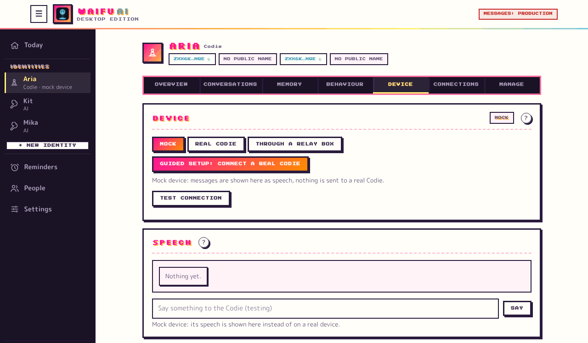

# 05 · Your Hologram Companion

📖 <a href="README.md">All guides</a> · Guide 5 of 7 · <a href="../../README.md">Home</a>

Give your companion a body. A Hologram Companion speaks its replies out loud, rings its own alarms and can
change the room's lights. ✨

No device yet? Start with the **practice (mock) device**: everything works the same, and spoken replies show as
text in the app. Switch to the real thing any time.

## You'll need (for a real device)

- Your Hologram Companion on the **same Wi-Fi** as this PC (or reachable over a private network, below).
- The device awake, unlocked and signed in.

## Connect it

**The easy way:** on the companion's **Device** tab, press **Guided setup**. It finds the address, saves it,
pairs, and checks that you hear it speak.

**By hand:**

1. Open the companion's **Device** tab.
2. Under **Device mode**, pick the real device instead of **Mock**, then connect.
3. Enter the device's address (like `http://<the device's IP>:8081`) and its time zone. The device's IP is in
   its own network settings, or in your router's list of devices. (The new-identity wizard can also look for it
   on your Wi-Fi.)
4. Press **Pair…**. The device shows a code: type it in.
5. Pick a session of about 12 hours, or a long-term one.
6. Press **Test the connection**.

Real-device support is the newest part of Waifu AI. Everything that isn't about the device (chat, messages,
memory, reminders, Discord) works the same with the practice device.

## Talk to it 🗣️

- **Who answers messages:** the hologram's own character (in its own voice), or the helper (your companion's
  brain, with tools).
- **By voice:** start with the wake word, then "remind me at 7 to call mum".
- **Speech:** the log of what it said. Type in the test box and press **Say** to hear it; nothing is sent
  anywhere.
- **Your OK first.** Anything said at the device that sends, spends or changes something waits for your
  approval **on your screen**. A spoken "yes" never approves it. Only the room's lights change at once.
- **"Don't…" is talk.** "Don't vote yes on that" changes nothing.

**Who counts as you?** A spoken line counts as yours only when it starts with the wake word **and** you used the
app or texted from your phone in the last 15 minutes. Otherwise it's "someone in the room": no memory and
nothing private (messages, contacts, notes, balances, orders, approvals), and it says "I can only share that
with my owner". Heads-up: while you count as present, anyone in the room saying the wake word gets your private
answers, even if you texted from somewhere else.

## Its own features (a paired real device)

- **Character:** which character it plays, and its slots. **Switch** changes slot; **Edit** then **Review
  changes…** saves changes on the device.
- **On the device:** the memory cards it made itself, read-only.
- **Alarms & reminders:** set, switch off and delete alarms and reminders that the device rings itself, even
  with the hub closed.
- **Clearing its chat history** (a button on the Device tab, which asks first): deletes what the device keeps
  of its own chats.

## The lights 💡

Ask from your phone or your Discord DM, in your own words:

- **On and off:** "turn the lights on", "lights off". If it can't tell on from off, nothing changes and it
  says so.
- **Colour:** a colour word ("blue", "pink", "warm white") or a colour code like `#ff8800`. "Black" or "off"
  switches them off.
- **Brightness:** 1 to 100 is a percent, so 1 means 1%, the dimmest.

## Quiet hours and notifications

- **Quiet hours** live in one place: **Settings → Quiet & away → Quiet hours**. Tick the switch to also silence
  your Hologram Companions there, and they keep the hub's hours: they say nothing except answers to what you
  asked, and what came in meanwhile becomes one line when quiet hours end. With it off, each device keeps its own
  hours, set on its **Device** tab.
- **What it says aloud** (Behaviour tab): how it tells you about new things: **Off**, **Chime**, or **Speak** (it
  says them). The same choice shapes your desktop pop-ups: Off shows none, Chime shows them without text.

## When it's offline

- You're told once, by text, after about ten minutes. Nothing is said aloud about it later.
- Messages are still answered, just not spoken. When it's back, what waited starts at once.
- Old announcements don't pile up: they become one line, "N messages came in while I was away. Open Waifu AI to
  read them."
- **Retry** on the Device card, or **Test the connection**, checks straight away.

## A device in another place

On another network (a holiday home, the office)? Use a private network such as Tailscale or WireGuard that gives
the device an address your PC can reach, and put that address in the Device card.

---

<a href="04-memory-and-dreams.md">← Memory and dreams</a> · <a href="README.md">All guides</a> · <a href="06-money-and-safety.md">Money and safety →</a>

