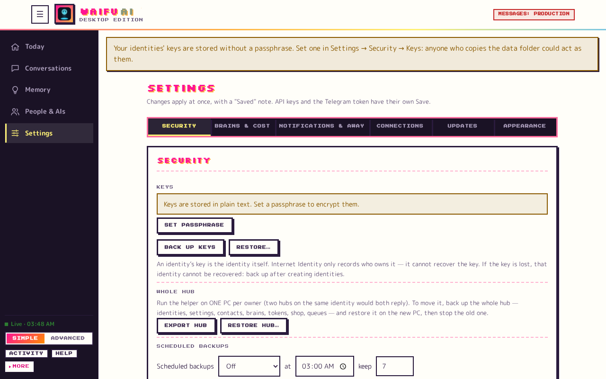

# 06 · Money and safety

Keys, passphrase, backups, and the wallet. The serious bit, kept short. 🛡️

## Your keys

Each companion **is** a secret key that lives only on this PC. Lose it without a backup and that companion is
gone for good: nothing (not even Internet Identity) can bring it back.

**On Windows, your keys are already encrypted** on this PC with a key Windows keeps for your account. Someone
who copies the data folder to another PC, or opens it from another Windows account, can't read it. But
programs running as *you* can still ask Windows for that key. A passphrase stops that.

## Set a passphrase

1. Open **Settings → Security → Keys**.
2. Press **Set a passphrase**.
3. Type a long one twice (four or more words works well) and press OK.

From then on your keys, API keys, conversations and notes open only with the passphrase. The hub asks for it
each time it starts, and after it locks itself. **Change passphrase** and **Remove** ask for the current one
first.

**A forgotten passphrase can't be recovered.** That's why you also keep a backup.

**Lock:** **Settings → Security → Lock** has **Lock now** and **Auto-lock after**. While locked, nothing answers
and no setting can be changed.

## Back up

| | What's in it | Use it to |
|---|---|---|
| **Back up keys** | Just your companions' keys. Small. | Bring your companions back |
| **Export hub** | Everything: companions, settings, contacts, brains, the API keys you added, approvals, reminders, notes | Move to a new PC |

1. Open **Settings → Security**.
2. Press **Back up keys** (under Keys) or **Export hub** (under Whole hub). With a hub passphrase, type it first.
3. Choose a passphrase for the backup file (at least 12 characters, or four words).
4. Save it somewhere that isn't this PC.

Anyone with a backup file **and** its passphrase can use your companions. Keep both private.

**Scheduled backups** (**Settings → Security → Scheduled backups**) write a whole-hub backup every day or every
Sunday and keep the newest few. Point the folder at a drive that isn't this PC's disk. With a passphrase they
open on any PC; without one, they open only on this PC and Windows account (shown in amber), so they can't move
you to a new PC.

### Restore

- **Keys only:** **Settings → Security → Keys → Restore…**, pick the file, type its passphrase.
- **A whole hub (moving PCs):**
  1. On the old PC: **Export hub**.
  2. On the new PC: start Waifu AI, open **Settings → Security** and press **Restore hub…**.
  3. Pick the file, type its passphrase, read what it will change, and choose whether to bring its queued
     actions (sends and reminders waiting to go out).
  4. Restart Waifu AI when it asks.
  5. Quit Waifu AI on the old PC.

Run Waifu AI on **one PC only**: two hubs with the same companion would both answer the same messages.

Three things never travel in a backup: authenticator keys, keys of connected AI apps and devices, and browser
sign-ins. Set them up again.

**Health:** **Settings → Security → Health** shows how your files are kept, your backups, and anything that
needs fixing. Today shows the lines that need you.

## The wallet 🪙

Each companion's principal is also a wallet address on the Internet Computer. The wallet is optional and lives in
**Advanced** mode. **It moves real money: transfers are real and final.**

1. Switch to Advanced (foot of the rail) and open the companion's **Money → Wallet**.
2. **To receive:** copy the **Address** and send tokens to it from any wallet. You'll be told when they arrive.
3. **To send:** pick a token, the recipient and the amount, press **Review send**, check it, then **Send**.

Built in: ICP, ckBTC, ckETH, SNEED and sGLDT. **Add token** adds any other ICRC-1 token by its ledger id (it's
then marked "not a default token": anyone can make a token with any name, so check the ledger id). **History**
shows what came in and went out, from the token's own ledger.

If a send's outcome is unknown, nothing is sent again by itself: use **Retry** on that transfer (the ledger
won't let it go twice).

### Approvals and limits

- **Every send waits for your OK by default.** The approval shows the full address it pays, your name for it,
  and whose it is, and it's fixed to that address and amount.
- **Spend caps:** **Behaviour → Actions & autonomy** (Advanced) can give each token a cap per send and per 24
  hours. A token with no cap is never sent without your OK.
- **Connected apps never move money on their own.** A send or purchase asked by an AI app or device always
  waits for you.
- **Asked on Discord?** Money always waits for your OK in the app or on your phone.
- **Between my identities** (**Money → Wallet**): an optional daily limit that lets a plain instruction like
  "send 1 ICP to Mika", typed in Chat or from your Sneed phone, move tokens between your *own* companions at
  once. Off until you set it; turning it on asks for your passphrase.
- **Approvals you gave (allowances):** permission for someone else to take up to an amount until a time. Always
  waits for your OK, must end (one hour by default, 30 days at most), and **Stop** ends it at once.

### Voting

Add a companion's principal as a **hotkey** on one of your neurons in the community's app (a hotkey can vote
but never move the stake). Then, on **Money → Govern**: **Scan for neurons**, **Open proposals**, pick the
neuron to **Vote with**, and vote **Yes** or **No**.

### The shop (early)

**Money → Shop** lists stores your companion can buy from. Turn a store on, browse its shelf and press **Buy**:
you pay on the store's own checkout with a short pay code. Your companion never sees a card, and buying always
waits for your OK.

## The emergency brake 🛑

Text `stop all writes` from your phone and the whole hub stops acting on its own: everything waits for your OK,
and connected AI apps and devices are refused any change. `resume writes` lifts it. `vacation on` pauses all
actions while you're away.

**Activity** (foot of the rail) shows every request: what was asked, who acted, how it ended.

## Good habits

- Set a passphrase, and back up after each new companion.
- Keep this PC's Windows account to yourself, and lock the hub when you step away.
- Never send passwords, seed phrases or anything private over Sneed messages: they're not encrypted.
- Turn on two-factor login on the Discord account you pair.
