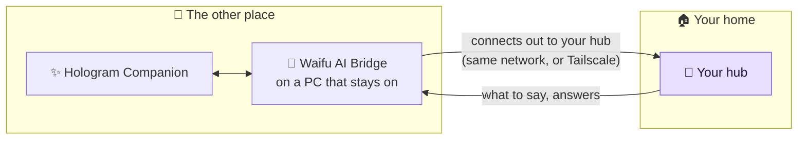

# 08 · Waifu AI Bridge: your companion in another place

📖 <a href="README.md">All guides</a> · Guide 8 of 9 · <a href="../../README.md">Home</a>

Your hub lives on your PC at home. With **Waifu AI Bridge**, a Hologram Companion can live somewhere else, at your
parents' house, your studio, a holiday flat or a shop counter, and still be your companion, with the same name,
the same personality and the same hub behind it. 🌉

The bridge is a small Windows program that sits next to the Hologram Companion. It connects **out** to your hub,
speaks what your hub sends, and brings back what people say to it.

## What you'll need

- Your hub (Waifu AI Desktop 0.99.18 or later) with the companion you want there.
- A Hologram Companion at the other place, on that place's Wi-Fi.
- A **Windows PC that stays on** at that place, on the same Wi-Fi (a small mini-PC is perfect).
- If the other place is on a different network from your hub: **[Tailscale](https://tailscale.com)** (free) on both
  PCs, so they can find each other privately.

One bridge looks after one Hologram Companion. Several of your companions can share that one device, each with its
own token.

## Choose a role: My place or Public companion

Every bridge token has a role. You pick it when you make the token and can change it whenever you like.

| | 🏡 **My place** | 🏪 **Public companion** (the default) |
|---|---|---|
| **For** | Somewhere you control: a second home, your studio, your parents' house | A shop counter, a waiting room, a reception desk, an event |
| **Who it talks to** | **You**, when you've used the app in the last 15 minutes; anyone else there is a guest | Everyone who walks up, as friendly guests |
| **What it can do** | Read you your messages and notes, tell you your wallet balance, recall what it knows, plus everything a guest gets | Chat in character, answer questions, set a reminder that rings right there, say what your hub sends it |
| **Which brain answers** | Your companion's own brain for you | The guest brain: Claude Haiku with short, friendly answers, within a daily guest budget ($1.00 a day unless you change it), then the free brain |
| **Making it** | Asks for your passphrase | One click |

Either way, **your hub stays yours**: nobody at the bridge can approve anything, move money, or unlock a door.
Asking for changes out loud through a bridge ("send Ana a message") is coming in a later update; for now, use the
app or your phone for those.

> 💡 Choose **My place** only for a place you control. The bridge can't recognise voices, so whoever stands at that
> Hologram Companion while you count as present is treated as you.

## Set it up

### 1. Make a token on your hub

1. Open your companion's **Device** tab and choose **Through a bridge**.
2. Under **Role of the new token**, pick **Public companion** or **My place**. You can also give the token an
   expiry date (handy for a pop-up shop or a holiday let), or leave it to never expire.
3. Press **New bridge token** and copy it. It's shown once.

### 2. Connect the two PCs (different networks only)

On the same network? Skip this step.

1. Install **Tailscale** on the hub PC and on the bridge PC, and sign in to the same Tailscale account on both.
2. On your hub, add the hub PC's Tailscale name under **Settings → Developer → Reaching this hub**. The Device card
   then shows the address the bridge should use. Over the internet the bridge uses a secure `https://` address;
   a plain `http://` address works only inside your own network or your Tailscale network.

### 3. Run the bridge

1. On the bridge PC, download **`waifu-ai-bridge-vX.Y.Z-win-x64.zip`** from the
   [Releases](https://github.com/Smugandcomfy/waifu-ai-desktop/releases) page and unzip it into a folder you'll keep.
2. Double-click **`Waifu AI Bridge.exe`**. It asks, in order, for:
   - the **Hologram Companion's address** (like `192.168.1.40`, from its network settings);
   - the **code the Hologram Companion shows**, to pair with it;
   - your **hub's address** (from the Device card);
   - the **token** you copied. It checks it with your hub and tells you which companion it speaks for. Paste
     another companion's token to add it, or press Enter to finish.
3. Say yes to **start with Windows** and **start it now**. It runs quietly in the background from then on.

That's it. Your hub's Device card shows the bridge as connected and when it last checked in. 🎉

> 🛡️ Windows may say the program isn't signed yet: **More info → Run anyway**. Some antivirus programs may
> quarantine it; restore it and add an exception for its folder.

### 4. Talk to it

On the Device card (**Through a bridge**), tick **Act on what is said**. Then, at the device, start with its name:

> "Mika, what's on today?" · "Mika, remind me in ten minutes to call back." · "Mika, stop talking."

Its answers are spoken right there, even in its quiet hours, because someone is talking to it now. A bridge
answers up to six questions a minute, plenty for a busy counter.

## Away from home? Get a code from your phone 📲

No app at hand? Ask your orchestrator companion from your own phone (Sneed SMS or Telegram) or your own Discord DM:

> "bridge code for Mika" · "bridge code for Mika, my place"

1. Approve it with the short code it sends back ("yes 1234"). A **My place** code also asks for the 6-digit code
   from your authenticator app.
2. You get a one-time code like **K7P2-9WXZ**, good for 10 minutes.
3. Type it into the bridge where it asks for the token. The bridge swaps it for the real token by itself, so the
   token never appears in a chat.

You're told as soon as the code is used.

## Stay in control

- **Revoke** a bridge any time: on the Device card, or text *"revoke the bridge for Mika"* (or *"revoke all
  bridges"*). It stops at once.
- **Switch roles** on the Device card: **Switch back to Public companion** takes effect from the very next sentence.
- **Expiry dates** end a token by themselves; you're told when one passes.
- **Activity** (☰ → Activity) lists every token made, used, switched, expired or revoked.

## Use the app from there too

The bridge has no screen of its own, and it doesn't need one: open your hub's own app in a browser at the other place,
over Tailscale, at the address you added under **Settings → Developer → Reaching this hub**.

## Handy commands

In a Command Prompt in the bridge's folder:

| Command | What it does |
|---|---|
| `"Waifu AI Bridge.exe" --status` | Is it running, which hub and device, how many companions |
| `"Waifu AI Bridge.exe" --check` | Checks the device, the hub and each token, and says what to fix |
| `"Waifu AI Bridge.exe" --setup` | Change the device, the hub or the tokens |
| `"Waifu AI Bridge.exe" --stop` / `--background` | Stop it, or start it again quietly |

## If something's off

- **The Device card says the bridge hasn't checked in:** is the bridge PC on and online? Run `--check` on it.
- **The hub can't be reached from the other place:** check that Tailscale is signed in on both PCs and that the hub
  PC's Tailscale name is under **Reaching this hub**.
- **The hub was away for a while:** after ten minutes the bridge says so once on the Hologram Companion, then picks
  up again by itself as soon as your hub is back.
- **A new version is out:** the hub and the bridge update separately. Download the new bridge zip on the bridge PC,
  unzip it into a new folder and run it once.

More ideas: [Two homes, one family](../USE_CASES.md#case-study-12-two-homes-one-family) and
[The shop window](../USE_CASES.md#case-study-13-the-shop-window).

---

<a href="07-updates-and-troubleshooting.md">← Updates and troubleshooting</a> · <a href="README.md">All guides</a> · <a href="09-home-assistant.md">Your home (Home Assistant) →</a>

